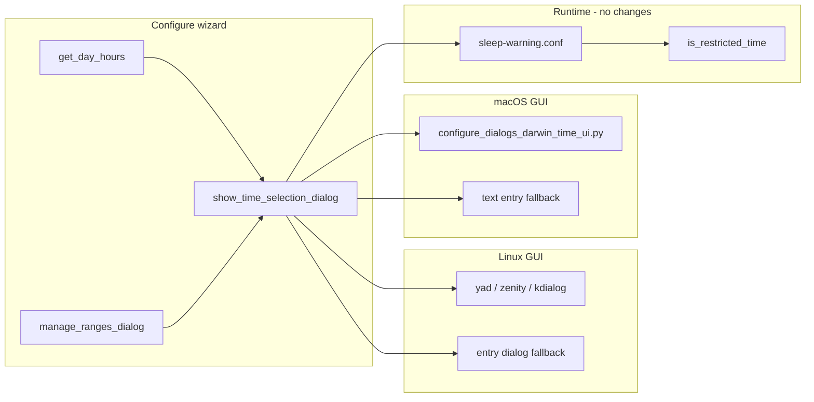

# 15-Minute Restriction/Block Time Resolution

## Plan review (verified against code + guidance)

This plan was re-checked against the current repo, [docs/SAFETY.md](docs/SAFETY.md), [AGENTS.md](AGENTS.md), and `.cursor/rules/config-file-edits.mdc`.

**Verdict:** Safe and narrowly scoped. The 30-minute limit exists only in GUI pickers; changing it does not weaken any of the three safety invariants. One test case in the original draft had incorrect duration math — corrected below.

**Scope confirmed:** GUI pickers only. Text mode (`--text`) continues to accept any valid minute (0–59).

---

## Current state (code audit)

The **30-minute limit is UI-only**. Backend already supports full minute precision end-to-end:

| Layer | Status | Key files |
|-------|--------|-----------|
| Parsing / normalization | Works for any `:00`–`:59` | [`lib/time-parsing.sh`](lib/time-parsing.sh) (`normalize_time_range`, `range_endpoint_to_day_minutes`) |
| Runtime restriction check | Uses `HHMM`; end is **exclusive** (`>= start` and `< end`) | [`lib/time-validation.sh`](lib/time-validation.sh) (`is_restricted_time`), [`sleep-warning.sh`](sleep-warning.sh) |
| Configure/manage block | Uses `is_restricted_time` | [`lib/time-validation.sh`](lib/time-validation.sh) (`check_config_lock_time`) |
| Config file chmod lock | Uses `is_restricted_time` (not hour-only `is_lock_hour`) | [`lib/config-locking.sh`](lib/config-locking.sh) lines 59–75 |
| Daily 16h cap math | Minute-precision | [`lib/daily-caps.sh`](lib/daily-caps.sh), [`lib/configure-validation.sh`](lib/configure-validation.sh) |
| Text-mode wizard | Already accepts `11:15pm-5:45am` | [`lib/configure-input-time.sh`](lib/configure-input-time.sh) |
| Linux GUI fallback | Free-text entry dialog when no yad/zenity/kdialog | [`lib/configure-dialogs-time.sh`](lib/configure-dialogs-time.sh) line 87–88 |
| macOS GUI fallback | Free-text entry when tkinter unavailable | [`lib/configure-dialogs-darwin.sh`](lib/configure-dialogs-darwin.sh) line 784–787 |

**Where 30 minutes is enforced today (complete list):**

- [`lib/configure-dialogs-time.sh`](lib/configure-dialogs-time.sh) — YAD `!00!30`, Zenity `00\|30`, KDialog `"00" "30"`
- [`lib/configure_dialogs_darwin_time_ui.py`](lib/configure_dialogs_darwin_time_ui.py) — `MINUTES = ["00", "30"]` and `_norm_minute()` that collapses anything except `30` to `00`

No other production files hard-code the 30-minute picker list (historical copies live under `backups/` and `dev-docs/enhancements/enhancement-16b-decisions-needed.md` only).

All three hour categories share the same picker via [`get_day_hours()`](lib/configure-input-time.sh) → [`show_time_selection_dialog()`](lib/configure-dialogs-time.sh) / macOS override in [`lib/configure-dialogs-darwin.sh`](lib/configure-dialogs-darwin.sh) → [`manage_ranges_dialog()`](lib/configure-dialogs.sh) (Add/Edit range). Applies to restriction hours, configure-block lock hours, and uninstall lock hours equally.



**Historical note:** Enhancement 16b decision doc listed Option D (00/15/30/45) but shipped Option B (00/30). This change implements Option D in the GUI only.

---

## Pre-existing limitations (out of scope)

These exist today with `:30` precision and are **not** introduced or fixed by this work:

| Area | Behavior | Why out of scope |
|------|----------|------------------|
| [`lib/configure-ui.sh`](lib/configure-ui.sh) live “next unrestricted” hints | Uses `is_hour_in_single_range()` which passes `:00` for the current minute | Hour-granularity display only; runtime popups still use full `HHMM` |
| [`store_lock_state()`](lib/config-locking.sh) reason label | Uses hour-only `is_lock_hour()` for metadata string | Cosmetic; active lock detection uses `is_restricted_time` |
| `is_lock_hour()` / `is_uninstall_lock_hour()` | Hour-only wrappers | Critical paths (`check_config_lock_time`, config lock active check) already call `is_restricted_time` |

Document in CHANGELOG only if we add a “known limitation” note; no code change required for this feature.

---

## Implementation

### 0. Backups (required before edit)

Per project backup rule, verify copies exist before modifying:

```bash
cp lib/configure-dialogs-time.sh "backups/configure-dialogs-time.sh-$(date +%Y%m%d_%H%M%S)"
cp lib/configure_dialogs_darwin_time_ui.py "backups/configure_dialogs_darwin_time_ui.py-$(date +%Y%m%d_%H%M%S)"
```

### 1. Shared minute-picker constants and prefill helper

Add near top of [`lib/configure-dialogs-time.sh`](lib/configure-dialogs-time.sh) (after header):

```bash
# GUI time picker minute quantum (restriction / lock / uninstall lock hours)
readonly TIME_PICKER_MINUTES=(00 15 30 45)

# Snap arbitrary minute (0-59) to nearest 15-min slot for combobox prefill when editing.
# Text-mode configs may use any minute; GUI edit prefill may round (e.g. :17 -> :15).
normalize_minute_for_picker() {
    local m=$((10#${1:-0}))
    if [ "${m}" -lt 0 ] || [ "${m}" -gt 59 ]; then
        echo "00"
        return 0
    fi
    printf "%02d" $(( (m + 7) / 15 * 15 % 60 ))
}

# Build YAD combobox value: ^DEFAULT!opt1!opt2!...
_yad_minute_cb_value() {
    local selected
    selected=$(normalize_minute_for_picker "${1:-0}")
    local out="^${selected}"
    local m
    for m in "${TIME_PICKER_MINUTES[@]}"; do
        out="${out}!${m}"
    done
    echo "${out}"
}
```

Use in all three Linux dialog implementations **after** `parse_normalized_time_to_12h` extracts `sm` / `em`:

```bash
sm=$(normalize_minute_for_picker "${sm}")
em=$(normalize_minute_for_picker "${em}")
```

YAD fields become:

```bash
--field="Minute:CB" "$(_yad_minute_cb_value "${sm}")"
```

Zenity: `--combo-values="00|15|30|45" --set "${sm}"` (both Start/End).

KDialog: `"00" "15" "30" "45"` in both minute comboboxes.

**Do not** change `parse_normalized_time_to_12h` — it already outputs `%02d` minutes for `:15` / `:45`.

### 2. macOS GUI — [`lib/configure_dialogs_darwin_time_ui.py`](lib/configure_dialogs_darwin_time_ui.py)

- `MINUTES = ["00", "15", "30", "45"]`
- Replace `_norm_minute()` with the same nearest-15 snapping as the shell helper (must stay in sync):

```python
def _norm_minute(value: str) -> str:
    allowed = {"00", "15", "30", "45"}
    v = str(value).strip().zfill(2)
    if v in allowed:
        return v
    try:
        m = int(v)
        return f"{((m + 7) // 15 * 15) % 60:02d}"
    except ValueError:
        return "00"
```

[`lib/configure-dialogs-darwin-time.py`](lib/configure-dialogs-darwin-time.py) and the tkinter daemon import this module — no separate changes.

### 3. Help text / docs

- [`user-docs/MACOS.md`](user-docs/MACOS.md) — table row “Time range entry”: `:00/:30` → `:00/:15/:30/:45`
- [`CHANGELOG.md`](CHANGELOG.md) — `[Unreleased]` UX note (patch-level; no semver bump unless you treat picker granularity as minor feature)
- Recommended (not optional): one line in [`lib/configure-ui.sh`](lib/configure-ui.sh) time-format help — GUI picker uses 15-minute steps; text mode accepts any minute

**Do not change** [`dev-docs/enhancements/enhancement-16b-decisions-needed.md`](dev-docs/enhancements/enhancement-16b-decisions-needed.md) — historical record.

### 4. Timer / popup interval (existing behavior, no code change)

[`check_minute_precision_compatibility()`](lib/configure-validation.sh) warns when `CHECK_INTERVAL > 15` and config has non-zero minutes (`:[1-5][0-9]` — covers `:15`, `:30`, `:45`). With 15-minute pickers, users should keep **popup check interval at 15 minutes or less** for timely triggers.

Note: Enhancement #30 uses `POPUP_DISPLAY_FREQUENCY` for popup throttling; `CHECK_INTERVAL` is the systemd/LaunchAgent timer cadence. Both affect how soon a `:15` start is noticed — mention both in manual smoke notes if interval is > 15.

---

## Range boundary semantics (for tests)

`is_time_in_single_range` treats the **end time as exclusive**:

- `23:15-05:45` overnight → restricted at `2315`, `0544`; **not** at `2314` or `0545`
- Same-day `17:00-17:30` → restricted at `1700`, `1729`; **not** at `1730`

---

## Testing

Per [config-file-edits.mdc](.cursor/rules/config-file-edits.mdc): use temp `HOME` / headless fixtures; do not edit installed config during restricted hours.

| Test | Purpose |
|------|---------|
| [`tests/test-16b-core.sh`](tests/test-16b-core.sh) | Overnight `23:15-05:45` at `2314`, `2315`, `0544`, `0545` |
| [`tests/test-range-endpoint-parsing.sh`](tests/test-range-endpoint-parsing.sh) | Endpoints `17:15`, `23:45` |
| [`tests/test-daily-caps.sh`](tests/test-daily-caps.sh) | `07:15-23:15` → 960 min (exactly 16h); **not** `07:15-23:45` (990 min = 16.5h) |
| [`tests/test-darwin-time-dialog.sh`](tests/test-darwin-time-dialog.sh) | `parse_normalized_time_to_12h "23:15"` and `"05:45"` |
| New [`tests/test-time-picker-minutes.sh`](tests/test-time-picker-minutes.sh) | `normalize_minute_for_picker`, `_yad_minute_cb_value` cases (`15`, `17→15`, `52→45`) |

[`tests/test-darwin-configure-gui.sh`](tests/test-darwin-configure-gui.sh) already runs `test-darwin-time-dialog.sh` — extending that file covers macOS wiring automatically.

After `lib/` changes: `./scripts/run-security-scan.sh --ci` (ShellCheck on changed `.sh` files).

**Manual GUI smoke (when you have a session):**

- Linux: set one day to `11:15 PM → 5:45 AM`; saved config shows `23:15-05:45`; Edit range prefills `:15`/`:45`
- macOS: same via `sleep-warning-configure --gui`
- With `POPUP_DISPLAY_FREQUENCY ≤ 15`, popup appears within one check cycle after start time

---

## Safety checklist ([docs/SAFETY.md](docs/SAFETY.md))

| Invariant | Impact |
|-----------|--------|
| Per-day 16h cap per category | Unchanged — [`lib/daily-caps.sh`](lib/daily-caps.sh) already uses minute endpoints; wizard hard-block unchanged |
| Popups must always end | Unchanged — no popup/scheduler edits |
| Always-available escape hatch | Unchanged — `systemctl`/`launchctl`/`sleep-warning-uninstall` unaffected |
| Cap at configure-time **and** runtime for `HH:MM` | Already satisfied; add `:15`/`:45 test cases only |
| Tests use temp `HOME` | Required for any configure integration tests |

No config migration needed. Existing `:00`/`:30` configs remain valid.

---

## Files to modify

| File | Change |
|------|--------|
| [`lib/configure-dialogs-time.sh`](lib/configure-dialogs-time.sh) | Constants, helpers, YAD/Zenity/KDialog minute options |
| [`lib/configure_dialogs_darwin_time_ui.py`](lib/configure_dialogs_darwin_time_ui.py) | `MINUTES` + `_norm_minute()` |
| [`user-docs/MACOS.md`](user-docs/MACOS.md) | Doc update |
| [`CHANGELOG.md`](CHANGELOG.md) | Unreleased note |
| `tests/test-16b-core.sh`, `tests/test-darwin-time-dialog.sh`, `tests/test-daily-caps.sh` | New cases |
| `tests/test-time-picker-minutes.sh` | New |

**Explicitly no changes:** `sleep-warning.sh`, `time-validation.sh`, `time-parsing.sh`, `configure-validation.sh`, systemd/LaunchAgent units, partial-lock logic, popup paths.

---

## Follow-ups (not in this PR)

- Upgrade configure-ui “live status” hints to minute precision (`get_current_time` + `is_restricted_time`)
- Optional text-mode validation enforcing 15-minute quantum (rejected for this scope)
- Consolidate kdialog’s 6-step time picker (separate Linux UX task; see `.cursor/plans/configure_gui_responsiveness_facddfc8.plan.md`)
