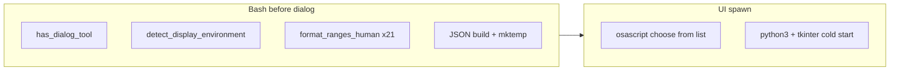
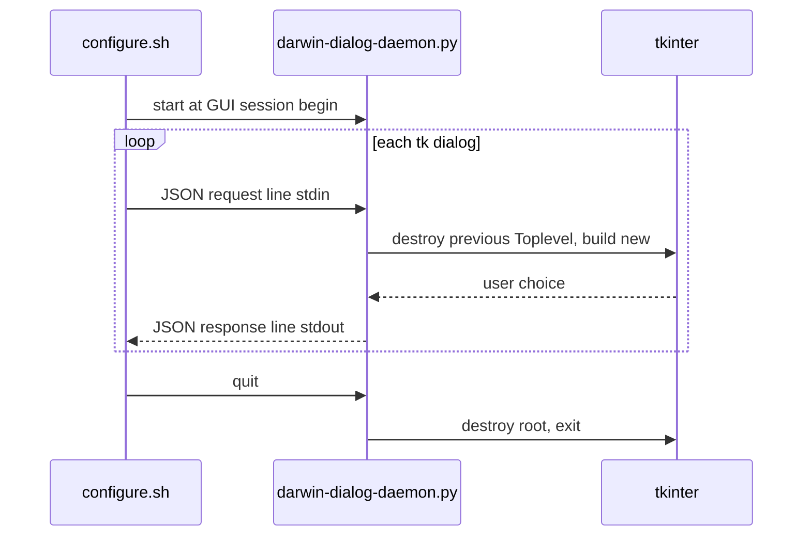

# Configure GUI responsiveness (macOS)

## Problem diagnosis

The configure wizard is a **single long-lived bash process** ([`configure.sh`](configure.sh)) that spawns a **new external UI process on every screen**. On macOS, latency you feel on each switch comes from three layers:

| Screen | macOS backend | Typical cost driver |
|--------|---------------|---------------------|
| Main menu, window submenu | osascript `choose from list` | `has_dialog_tool` → full Linux-oriented display probe; `activate` each time |
| Weekly grid (option 9) | tkinter table (4 columns) | **Python interpreter + Tk init every refresh**; 21× `format_ranges_human` in bash first |
| Time range editor | tkinter time form | Same Python cold start per range edit |
| Summary save | tkinter scroll + buttons | Same Python cold start |

What is **not** the main issue: re-sourcing libs, reloading config from disk between menu items, or chmod (those happen at startup / save only).

---

## Phase 1 — Quick wins (bash only, low risk)

### 1A. macOS-fast paths in dialog tool detection

[`lib/configure-core.sh`](lib/configure-core.sh) `has_dialog_tool()` and `get_dialog_tool()` always call `detect_display_environment()` ([lines 119–151](lib/configure-core.sh)), which probes X11/Wayland/loginctl — useless on Darwin and invoked **before every GUI screen** via `has_dialog_tool` in [`lib/configure-display.sh`](lib/configure-display.sh).

**Change:** Early-return on Darwin:
- `has_dialog_tool` → `command -v osascript`
- `get_dialog_tool` → echo `osascript` (config `DIALOG_TOOL` is already ignored on macOS)

Cache result in session globals `_CONFIGURE_CACHED_DIALOG_TOOL` / `_CONFIGURE_HAS_DIALOG_TOOL` after first call; invalidate only if menu 11 changes tool on Linux (no-op on macOS).

### 1B. Stop re-reading the config file during menu build

Several helpers grep `~/.config/sleep-warning/...` even though values are already in memory from `load_existing_config()`:

- [`configure.sh`](configure.sh) lines 292–293: `get_dialog_tool_config` grep → use `dialog_tool` global
- [`lib/configure-display.sh`](lib/configure-display.sh) `_get_effective_popup_size_mode` / `format_popup_size_display` (lines 69–71, 118–119): grep when overrides empty → use globals passed from main loop
- [`show_window_behavior_submenu`](lib/configure-display.sh) lines 499–507: seven greps when args empty → callers already pass memory values; delete fallback greps or gate behind `CONFIGURE_ALLOW_DISK_FALLBACK=1` for tests only

### 1C. Remove dead work in hot paths

- Delete unused `tmpfile=$(mktemp)` in `show_main_menu` ([lines 235–236](lib/configure-display.sh)) — currently leaks a temp file every main-menu show
- Replace lock/uninstall status loops in [`configure.sh`](configure.sh) (lines 257–281) with two boolean flags updated when lock arrays mutate (set in workflow/input functions), so the main loop only reads flags

### 1D. Optional profiling hook

Add `CONFIGURE_PROFILE=1` timing around `show_*_dialog` wrappers in [`lib/configure-dialogs-darwin.sh`](lib/configure-dialogs-darwin.sh) (stderr: `dialog=table prep_ms=… ui_ms=…`). Makes before/after verification objective without affecting normal runs.

**Expected gain:** tens to low hundreds of ms per switch; noticeable on main-menu ↔ submenu hops, not transformative for tkinter screens.

---

## Phase 2 — Cache expensive grid formatting (bash)

[`show_visual_grid`](lib/configure-display.sh) rebuilds formatted hour strings for 7 days × 3 categories on **every loop iteration** (lines 616–696), then serializes a large JSON payload for Python.

**Change:** Add `_configure_grid_cache_invalidate()` called when `summary_lines`, `lock_hours_lines`, or `uninstall_lock_hours_lines` change. Cache parallel arrays `grid_day_names[]`, `grid_restricted[]`, etc. Rebuild only on invalidation or first show.

**Expected gain:** 50–200 ms before weekly-grid tkinter spawn (depends on range count); pairs well with Phase 3.

---

## Phase 3 — Long-lived Python dialog daemon (biggest win)

You confirmed openness to this approach. Target: **one tkinter root for the whole configure session** for table, time, and text/summary dialogs.

### Architecture

### New files

- [`lib/configure-dialogs-darwin-daemon.py`](lib/configure-dialogs-darwin-daemon.py) — event loop reading **newline-delimited JSON** from stdin; dispatches to existing UI builders extracted from:
  - [`configure-dialogs-darwin-table.py`](lib/configure-dialogs-darwin-table.py)
  - [`configure-dialogs-darwin-time.py`](lib/configure-dialogs-darwin-time.py)
  - [`configure-dialogs-darwin-text.py`](lib/configure-dialogs-darwin-text.py)
- Refactor those three scripts into importable modules (e.g. `configure_dialogs_darwin_table_ui.py`) so daemon and one-shot CLI modes share code

### Bash integration ([`lib/configure-dialogs-darwin.sh`](lib/configure-dialogs-darwin.sh))

- `_cd_darwin_daemon_start()` — after `_cd_darwin_has_tkinter` succeeds, spawn `python3 …/configure-dialogs-darwin-daemon.py` with coprocess or FIFO pair; store fd/PID in globals
- `_cd_darwin_daemon_request(type, json_payload)` — write request, read response with timeout (e.g. 600s for user think time)
- `_cd_darwin_daemon_stop()` — send `{"op":"quit"}`, wait for exit; trap EXIT in [`configure.sh`](configure.sh) `main()` cleanup
- `_cd_darwin_show_table_dialog`, `_cd_darwin_show_time_dialog`, `_cd_darwin_show_text_dialog` → daemon first; **fallback** to current one-shot `python3 script < json` if daemon fails to start or dies mid-session

### Protocol sketch

Request: `{"op":"table","title":"…","columns":[…],"rows":[…],…}`  
Response: `{"ok":true,"value":"Sunday"}` or `{"ok":false,"cancelled":true}`

Keep [`configure_dialogs_darwin_window.apply_initial_frontmost`](lib/configure_dialogs_darwin_window.py) on each Toplevel (still needed for focus); drop repeated **interpreter** startup.

### Safety / UX constraints (unchanged)

- No change to validation, partial lock, or save path
- Daemon is **configure-only**; warning popups stay on existing watchdog paths
- If tkinter unavailable, existing osascript fallbacks remain

**Expected gain:** ~200–800 ms per tkinter dialog (Python + Tk cold start eliminated). Weekly grid and time editing should feel dramatically snappier.

---

## Phase 4 — osascript micro-optimizations (optional, after Phase 3)

For 2-column menus (main menu, window submenu):

- Skip redundant `tell current application to activate` when the previous dialog closed <500 ms ago and configure still owns focus (track `_CD_LAST_DIALOG_TS`)
- Keep activate on first dialog and after tkinter dialogs (required for z-order — already documented in [`configure-ui.sh`](lib/configure-ui.sh))

Measure with `CONFIGURE_PROFILE=1` before tuning; do not weaken initial frontmost behavior.

---

## Verification

| Check | Command / method |
|-------|------------------|
| Existing darwin dialog tests | `bash tests/test-darwin-multi-column-parse.sh`, `bash tests/test-darwin-time-dialog.sh`, `bash tests/test-configure-dialogs.sh` |
| Manual macOS script | `./tests/test-dialog-sizes-interactive.sh` or normal `./configure.sh` — hop main menu ↔ window behavior ↔ weekly grid |
| Profile comparison | `CONFIGURE_PROFILE=1 ./configure.sh` before/after; target: `ui_ms` for table/time drops sharply in Phase 3 |
| Safety regression | No changes to [`lib/configure-validation.sh`](lib/configure-validation.sh) / caps; run `bash tests/test-configure-partial-lock.sh` if partial-lock paths touched |
| Security scan | `./scripts/run-security-scan.sh --ci` after `lib/` changes |

---

## Suggested implementation order

1. **Phase 1** — ship first; immediate improvement, minimal review surface
2. **Phase 2** — grid cache; small diff, helps grid even before daemon
3. **Phase 3** — daemon; largest UX win; refactor Python modules + bash coprocess + tests for protocol/fallback
4. **Phase 4** — only if profiling shows osascript still dominates 2-column menus

## Out of scope (for this effort)

- Linux yad/zenity/kdialog (you use macOS); kdialog 6-step time picker consolidation remains a separate Linux task
- Merging configure into a native app or web UI
- Weakening tkinter frontmost / z-order workarounds

## Documentation

- Short section in [`dev-docs/CONFIGURE_GUI_FLOW.md`](dev-docs/CONFIGURE_GUI_FLOW.md) describing daemon lifecycle and `CONFIGURE_PROFILE`
- [`CHANGELOG.md`](CHANGELOG.md) entry under **Performance** (patch/minor depending on daemon default-on behavior)
