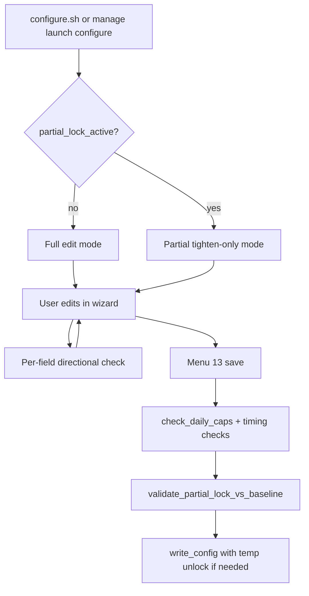

# Partial configure during lock hours (tighten-only mode)

## Problem today

When `CONFIGURE_BLOCK_ENABLED=true` and the current time is in restriction hours or `CONFIG_LOCK_HOURS_*`, [`configure.sh`](configure.sh) calls `check_config_lock_time()` and **exits immediately** (lines 198–203). The same check blocks **Configure Restricted Hours** in [`manage.sh`](manage.sh) (lines 609–615). Separately, `CONFIG_LOCK_ENABLED` + [`is_config_lock_active()`](lib/config-locking.sh) blocks the wizard at startup (lines 205–226) because the config file is read-only.

There is **no** old-vs-new comparison anywhere; validation is stateless on the proposed full config ([`check_daily_caps`](lib/daily-caps.sh), [`check_restriction_coverage`](lib/configure-validation.sh)).

## Goal

During **any** active configure/config-file lock window, allow **tighten-only** edits:

| Area | Allow (tighten) | Block (loosen) |
|------|-----------------|----------------|
| Popup frequency (`POPUP_DISPLAY_FREQUENCY`) | Lower value → more frequent checks | Raise value |
| Min display (`POPUP_MIN_DISPLAY_TIME`) | Increase seconds | Decrease |
| Restriction / config-lock / uninstall-lock hours | **Add** new ranges; keep every existing range byte-identical (after normalize) | Edit, remove, or clear a day that had ranges |
| `CONFIGURE_BLOCK_ENABLED`, `CONFIG_LOCK_ENABLED` | `false` → `true` | `true` → `false` |
| `UNINSTALL_PROTECTION_MODE` | `none` → `difficult` | `difficult` → `none` |
| Other lockout-related settings (your choice: tighten-only for all) | See matrix below | Opposite direction |

**Still required on every save:** per-day 16 h cap per category ([`docs/SAFETY.md`](docs/SAFETY.md)), `validate_popup_timing_config`, lock re-check before write, escape hatch unchanged (`systemctl`/`launchctl` bootout, uninstall, manage **Disable Service**).



## Tighten-only matrix (extended settings)

Implement as explicit rules in a new module (not ad hoc per menu item):

| Setting | Tighten (allow) | Loosen (block) |
|---------|-----------------|----------------|
| `POPUP_IMMOVABLE` | `false` → `true` | `true` → `false` |
| `POPUP_AUTO_CLOSE` | **Neutral** — both `true` → `false` and `false` → `true` allowed (see rationale below) | *(none — not directional)* |
| `PAUSE_ENABLED` | `true` → `false` | `false` → `true` |
| `PAUSE_DURATION` | Decrease minutes | Increase |
| `PAUSE_ONCE_PER_DAY` | `false` → `true` | `true` → `false` |
| Popup size mode/size | Larger / more intrusive modes only | Smaller / less intrusive |
| `POPUP_POSITION`, `DIALOG_TOOL`, service mode | No change | Any change |

Popup timing cross-check (`validate_popup_timing_config`) stays as today.

### `POPUP_AUTO_CLOSE` rationale (not loosening)

The wizard exposes `POPUP_AUTO_CLOSE` as a **boolean only** ([`get_popup_auto_close_config`](lib/configure-input-popup.sh)); delay is fixed via `POPUP_AUTO_CLOSE_DELAY_SECONDS` in [`lib/popup-safety.sh`](lib/popup-safety.sh), not user-editable.

**Disabling auto-close is not treated as loosening:**

- With `POPUP_AUTO_CLOSE=false`, Linux still enforces min-display and the absolute watchdog ([`popup_compute_watchdog_seconds`](lib/popup-safety.sh) — uses `min_display + delay + 15` or floor 60s); popups remain finite per [docs/SAFETY.md](docs/SAFETY.md).
- macOS may still force auto-close at runtime when `DARWIN_FORCE_AUTO_CLOSE=true` ([`popup_assert_safe_config`](lib/popup-safety.sh)); partial-lock validation must not assume `false` in file == `false` at runtime — document in user docs.

**Partial-lock rule:** omit `POPUP_AUTO_CLOSE` from `configure_partial_lock_validate_scalar` directional checks; allow free toggle during partial mode. Still run `validate_popup_timing_config` if min display / interval change in the same session.

## Architecture

### 1. New module: [`lib/configure-partial-lock.sh`](lib/configure-partial-lock.sh)

Core API (names can match repo style):

- `configure_partial_lock_is_active()` — true when `check_config_lock_time` would block **or** `is_config_lock_active` is true (covers script block + filesystem lock).
- `configure_partial_lock_capture_baseline()` — after `load_existing_config()`, copy scalars + `config_lines` / `lock_hours_lines` / `uninstall_lock_hours_lines` into `_baseline_*` globals (session-only).
- `configure_partial_lock_ranges_add_only(old_csv, new_csv)` — every normalized range in `old` appears in `new`; `new` may have extras.
- `configure_partial_lock_validate_scalar(field, old, new)` — bool/enum/int rules above (**exclude** `POPUP_AUTO_CLOSE`).
- `configure_partial_lock_validate_proposed()` — full diff baseline → current in-memory state; returns human-readable error list.
- `configure_partial_lock_show_banner(use_gui)` — welcome text: “Limited changes only during lock hours…”

Keep logic **mechanical** (same spirit as `daily-caps.sh`); add unit tests without GUI.

### 2. Entry points

**[`configure.sh`](configure.sh)** (startup ~198–226):

- If `configure_partial_lock_is_active`: set `CONFIGURE_PARTIAL_LOCK_MODE=true`, call `configure_partial_lock_capture_baseline()`, show banner; **do not** `exit 1`.
- If config file is chmod-locked, same path (partial mode handles write via unlock — see below).

**[`manage.sh`](manage.sh)** (case “Configure Restricted Hours”):

- When `_config_locked=true`, call `launch_configure` instead of `show_config_locked_error` (configure auto-detects partial mode).
- Optional: append “(limited changes during lock hours)” to that menu label when locked.

### 3. Per-edit hooks (UX + early failure)

| Location | Change |
|----------|--------|
| [`lib/configure-input-time.sh`](lib/configure-input-time.sh) `get_check_interval` | After user input, reject if `new > baseline` |
| [`lib/configure-input-popup.sh`](lib/configure-input-popup.sh) | Min display + immovable: directional rules; **auto-close: no directional block** |
| [`lib/configure-input-popup-size.sh`](lib/configure-input-popup-size.sh) | Size tighten-only |
| [`lib/configure-input-features.sh`](lib/configure-input-features.sh) | Security toggles: only offer enabling when baseline is false; block disable in GUI list and text prompts |
| [`lib/configure-dialogs.sh`](lib/configure-dialogs.sh) `manage_ranges_dialog` | When partial mode: menu = **Add range (+)** and **Done** only (hide Edit / Remove) |
| [`lib/configure-workflow.sh`](lib/configure-workflow.sh) `get_day_hours` | For new-day flow, allow add; reject returning empty if baseline had ranges |
| [`configure.sh`](configure.sh) main menu | On disallowed menu picks, `show_error_dialog` with one-line reason (optional: dim labels in [`lib/configure-display.sh`](lib/configure-display.sh) `show_main_menu`) |

### 4. Save path

**[`configure.sh`](configure.sh)** case 13, before `write_config`:

1. Existing: `check_daily_caps`, `check_restriction_coverage`, `check_config_lock_time` (re-check).
2. **New:** if `CONFIGURE_PARTIAL_LOCK_MODE=true`, run `configure_partial_lock_validate_proposed`; on failure → `show_cap_violation_error`-style dialog (reuse or add `show_partial_lock_violation_error` in [`lib/configure-ui.sh`](lib/configure-ui.sh)).

**[`lib/configure-config.sh`](lib/configure-config.sh)** `write_config`:

- If `is_config_lock_active` at write time: call existing unlock helpers in [`lib/config-locking.sh`](lib/config-locking.sh) (`restore_config_directory_permissions` / pair used by `sleep-warning.sh`), write atomically, re-apply lock if still active.

**Session rule:** If partial mode was entered at start, keep tighten-only rules for the **whole session** even if the clock exits lock before save (prevents “wait until unlock then loosen” in one sitting).

### 5. Tests

New [`tests/test-configure-partial-lock.sh`](tests/test-configure-partial-lock.sh):

- `ranges_add_only`: old `9-17`, new `9-17,20-22` OK; remove/edit/clear fail.
- Scalar directions: interval, min display, bool locks.
- Full `validate_proposed` with fixture baseline arrays (no installed config; temp `HOME` per [tests rule](.cursor/rules/tests.mdc)).
- Regression: `check_daily_caps` still blocks 17 h day when only *adding* ranges.

Run on macOS: `bash tests/test-configure-partial-lock.sh`; existing `tests/test-daily-caps.sh` unchanged.

### 5b. Verification and edge-case tracing (required before calling done)

After implementation, **trace code paths** (do not rely on tests alone) and record results in the PR / commit notes.

**Trace matrix — what to follow and what must remain true:**

| Risk | Code to trace | Expected behavior |
|------|---------------|-------------------|
| **24/7 lockout** | [`check_restriction_coverage`](lib/configure-validation.sh) at save; [`validate_config_safety`](sleep-warning.sh) at runtime | Adding ranges in partial mode cannot bypass weekly `THRESHOLD_BLOCK` or per-day 16 h cap |
| **Per-day 16 h cap** | [`check_daily_caps`](lib/daily-caps.sh) on proposed full state after add-only edits | e.g. baseline `0-12,12-23` + new range still blocked; partial validator does not replace cap check |
| **Add-only bypass** | [`configure_partial_lock_ranges_add_only`](lib/configure-partial-lock.sh) + [`manage_ranges_dialog`](lib/configure-dialogs.sh) text-mode paths | Edit/remove hidden in GUI; text mode cannot skip dialog; normalize before compare (`normalize_time_range`) |
| **Overnight carry** | [`check_config_lock_time`](lib/time-validation.sh), [`daily-caps.sh`](lib/daily-caps.sh) `_compute_day_merged_minutes` | Adding evening range does not accidentally shrink prior-day carry; cap counts merged minutes correctly for HH:MM |
| **Session clock escape** | [`configure.sh`](configure.sh) save with `CONFIGURE_PARTIAL_LOCK_MODE` set at entry | User who entered partial mode at 11:58 cannot save loosening edits at 12:02 same session |
| **Config file chmod** | [`write_config`](lib/configure-config.sh) + [`config-locking.sh`](lib/config-locking.sh) unlock/re-lock | Write succeeds; permissions restored; no orphaned writable config left locked-out |
| **Auto-close off + long min display** | [`validate_popup_timing_config`](lib/configure-validation.sh), [`popup_compute_watchdog_seconds`](lib/popup-safety.sh), [`popup-display.sh`](lib/popup-display.sh) / darwin spawn | Save allowed when auto-close disabled; runtime watchdog still ≤ `POPUP_ABSOLUTE_MAX_SECONDS` |
| **Loosening via other fields** | Full `configure_partial_lock_validate_proposed` | Disabling locks, removing hours, slower popup interval, shorter min display all rejected at save |
| **Escape hatch** | [`manage.sh`](manage.sh) disable service; [`uninstall.sh`](uninstall.sh) | Unchanged — not gated by partial mode |

**Automated runs (temp `HOME`, never installed config during restricted hours):**

```bash
bash tests/test-configure-partial-lock.sh
bash tests/test-daily-caps.sh
bash tests/test-popup-safety-darwin.sh   # if on macOS
bash tests/test-platform-darwin.sh       # if on macOS
```

**Manual smoke (when safe — outside restricted hours or temp install):**

1. Enable `CONFIGURE_BLOCK_ENABLED`, enter restriction window → configure opens in partial mode with banner.
2. Add a non-overlapping range → save OK; try remove same range → blocked.
3. Lower popup frequency → OK; raise → blocked.
4. Toggle auto-close off → save OK; confirm popup still terminates (watchdog / min-display).
5. From manage → Configure during lock → partial mode (not hard error).

### 6. Documentation

- [`docs/SAFETY.md`](docs/SAFETY.md) — new subsection: partial lock is tighten-only; does not weaken 16 h cap or escape hatch; `manage` disable / `launchctl` / uninstall still allowed.
- [`user-docs/CONFIGURATION.md`](user-docs/CONFIGURATION.md) or [`user-docs/MACOS.md`](user-docs/MACOS.md) — user-facing table of what can change during lock.
- [`CHANGELOG.md`](CHANGELOG.md) — minor feature entry (behavior change for users who relied on total block).
- [`dev-docs/TO_DO.md`](dev-docs/TO_DO.md) — optional backlog item to track completion.

### 7. Backups

Per your rule: copy any modified `lib/configure-*.sh`, `configure.sh`, `manage.sh` to `backups/` with timestamp **before** editing.

## Safety checklist (must pass before merge)

- [ ] No path allows removing restriction hours or disabling locks during partial mode.
- [ ] Add-only hours still subject to `check_daily_caps` (cannot add past 16 h/category/day).
- [ ] `check_restriction_coverage` still blocks pathological weekly totals (24/7 backstop).
- [ ] `POPUP_AUTO_CLOSE` toggles freely in partial mode; popup lifetime invariant still holds (watchdog on all spawn paths).
- [ ] `write_config` cannot fail silently on chmod-locked dir (unlock → write → re-lock).
- [ ] Escape hatch: uninstall, timer stop, manage disable service unchanged.
- [ ] Tests use temp `HOME`; no edits to installed config during restricted hours.
- [ ] Section **5b trace matrix** completed and any findings fixed before merge.

## Out of scope (this pass)

- `--force` emergency full override (mentioned in enhancement-19 doc but not implemented).
- Separate timer interval ([enhancement-30](dev-docs/enhancements/enhancement-30-separate-timer-check-interval-from-popup-display-frequency.md)) — only `POPUP_DISPLAY_FREQUENCY` until that lands.
- Runtime enforcement if user hand-edits config during lock (optional follow-up: mirror rules in `validate_config_safety`).
