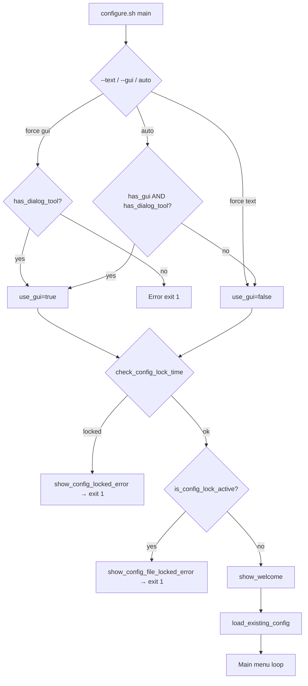
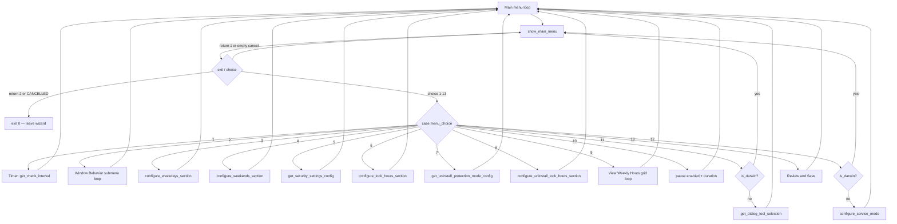
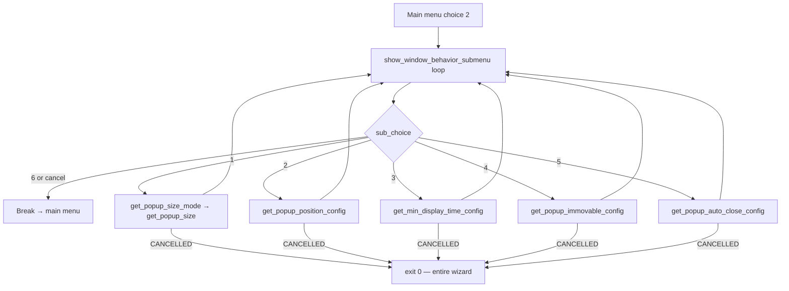
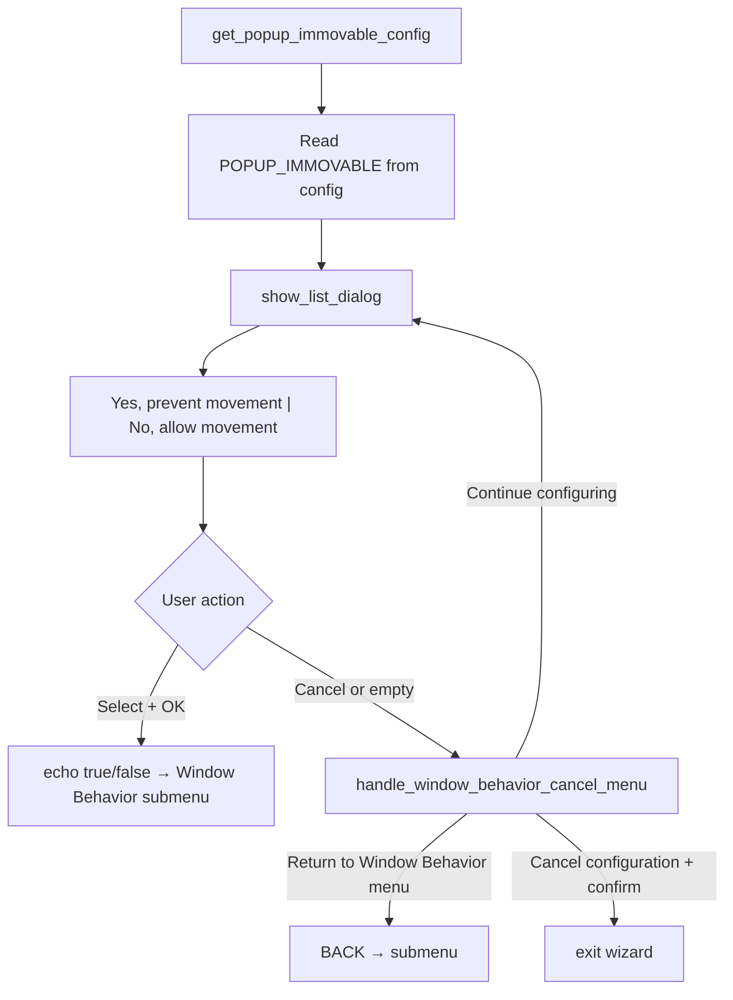
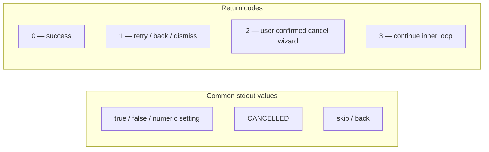
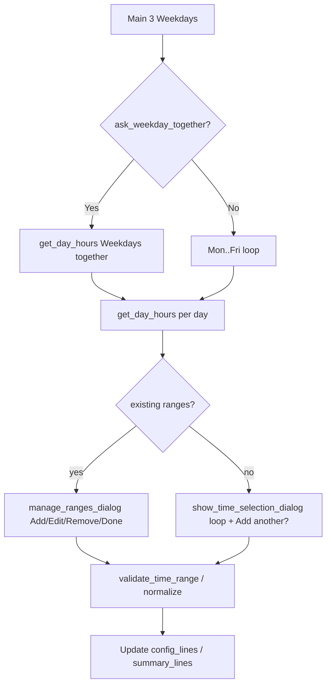
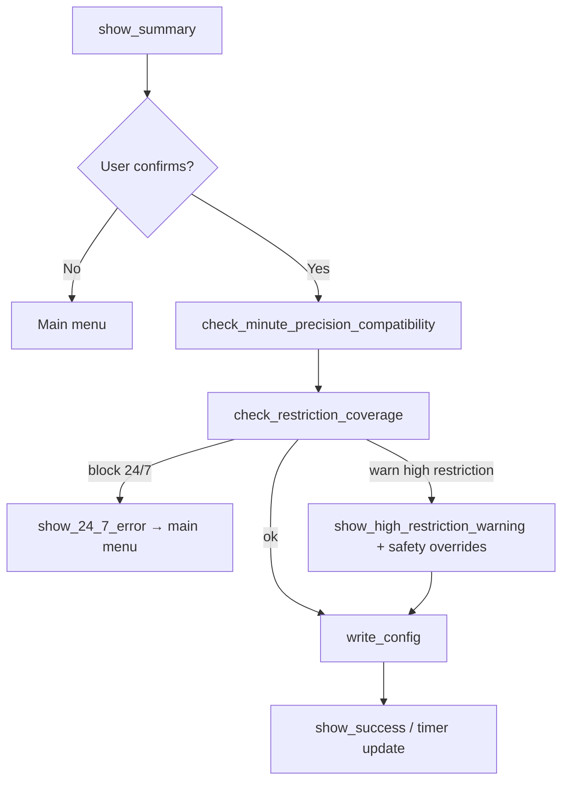

# Configure GUI flow trace

Reference for `sleep-warning-configure --gui` (and `./configure.sh --gui`). Traces dialog paths, cancel semantics, and known UX traps — including the **“Prevent popup window from being moved”** prompt where users often feel stuck.

**Entry script:** `configure.sh` → `main()`  
**Platform overlay:** `lib/configure-dialogs-darwin.sh` (macOS) overrides Linux yad/zenity/kdialog helpers.

---

## Startup and guards

| Step | Function / file | Notes |
|------|-----------------|-------|
| GUI detection | `has_gui()` / `has_dialog_tool()` in `configure-core.sh` | macOS: `osascript` smoke test; tool = `osascript` via `desktop-environment.sh` |
| Script lock | `check_config_lock_time()` | Blocks running configure during restricted/lock hours |
| File lock | `is_config_lock_active()` | Read-only config during lock |
| Welcome | `show_welcome()` in `configure-ui.sh` | Info only |

---

## Main menu loop

### Main menu options (GUI)

| # | Label | Handler | macOS notes |
|---|--------|---------|-------------|
| 1 | Timer Settings | `get_check_interval()` | Entry dialog / validation |
| 2 | Window Behavior | Submenu (below) | Full submenu |
| 3 | Weekdays | `configure_weekdays_section()` | Time picker + range editor |
| 4 | Weekends | `configure_weekends_section()` | Same |
| 5 | Script blocking + config lock | `get_security_settings_config()` | List true/false flows |
| 6 | Additional config block hours | `configure_lock_hours_section()` | Info dialog then day hours |
| 7 | Uninstall protection | `get_uninstall_protection_mode_config()` | |
| 8 | Uninstall lock hours | `configure_uninstall_lock_hours_section()` | |
| 9 | View Weekly Hours | `show_visual_grid()` → `configure_day_from_grid()` | tkinter 4-column table on macOS |
| 10 | Pause | `get_pause_enabled_config()` + duration | |
| 11 | Dialog tool | Skipped on Darwin | Message to stderr, `continue` |
| 12 | Service mode | Skipped on Darwin | Message to stderr, `continue` |
| 13 | Review and Save | `show_summary()` → validation → `write_config()` | |

**Main menu cancel:** Closing the list or Cancel → `handle_main_menu_cancel_menu()` → "Exit without saving" + confirm = `return 2` → `exit 0`; "Continue configuring" or dismissing the cancel menu = `return 1` → show main menu again.

**Empty OK on menu:** Re-shows the menu (does not default to any option).

---

## Window Behavior submenu (path to “immovable”)

Submenu is implemented in `configure-display.sh` (`show_window_behavior_submenu`) and driven from `configure.sh` case `2`.

| Sub # | Action | Input function |
|-------|--------|----------------|
| 1 | Popup size | `get_popup_size_mode_config` → `get_popup_size_config` |
| 2 | Position | `get_popup_position_config` |
| 3 | Min display time | `get_min_display_time_config` |
| 4 | **Immovable** | **`get_popup_immovable_config`** |
| 5 | Auto-close | `get_popup_auto_close_config` |
| 6 | Back | `return 1` → main menu |

---

## Immovable prompt — detailed trace (where users get stuck)

**Trigger:** Main menu **2** → Window Behavior **4** → `get_popup_immovable_config()` in `lib/configure-input-popup.sh`.

### What the dialog shows

- **List items:** `Yes, prevent movement` / `No, allow movement` (mapped to `true` / `false` in config).
- **macOS:** Extra note that enforcement is **Linux only**; submenu shows `Immovable — On/Off (Linux only)`.

### Cancel behavior (updated)

| Action | Result |
|--------|--------|
| Select Yes/No + OK | Save setting → **Window Behavior submenu** |
| Cancel → **Return to Window Behavior menu** | **Submenu** (no longer stuck) |
| Cancel → **Continue configuring** | Same immovable list again |
| Cancel → **Cancel configuration** + confirm | Exit wizard |

### Historical note (pre-2026-05)

Previously: raw `true`/`false` labels; Cancel + Continue looped forever; Cancel + confirm exited entire wizard with no way back to submenu.

### Contrast: time-range cancel

Weekday/hour entry still uses `_handle_day_hours_cancel_menu()` with Skip / Go back / Cancel configuration / Continue configuring.

---

## Cancel and return-code semantics

| Location | Cancel / dismiss behavior |
|----------|---------------------------|
| Main menu | `handle_main_menu_cancel_menu` → "Exit without saving" + confirm: exit wizard; "Continue configuring" or dismiss: main menu |
| Window Behavior submenu item (1–5) | Cancel menu → **Return to Window Behavior menu** = submenu; **Cancel configuration** + confirm = exit wizard; dismiss cancel-menu = back to submenu |
| Window Behavior submenu (list cancel) | `return 1` → main menu |
| `get_popup_immovable_config` | Cancel → cancel-menu → Back = submenu; "Cancel wizard" + confirm = exit; Continue = same immovable list |
| `get_min_display_time_config` | Same pattern as immovable |
| `get_day_hours` Phase 2 (edit existing) | Cancel manage dialog → cancel-menu → skip/back/cancel wizard/continue; "continue" re-shows manage dialog |
| `get_day_hours` Phase 1 (new day) | Cancel → cancel-menu → skip/back/cancel wizard/continue |
| Grid option 9 → `configure_day_from_grid` return 2 | `exit 0` (exits wizard, same as options 3/4/6/7/8) |
| Review and Save | "Back to Main Menu" on summary → main menu; validation fail → main menu |

---

## Weekdays / time ranges (high level)

Grid path (main **9**): `show_visual_grid` → pick day → `configure_day_from_grid` → `ask_what_to_edit` → restricted / lock / uninstall lock / all.

---

## Review and Save (option 13)

---

## Module map (GUI-related)

| File | Role |
|------|------|
| `configure.sh` | Main loop, menu `case`, submenu loops |
| `lib/configure-display.sh` | `show_main_menu`, `show_window_behavior_submenu`, `show_visual_grid`, `show_summary` |
| `lib/configure-input-popup.sh` | Window behavior inputs including **`get_popup_immovable_config`** |
| `lib/configure-input-popup-size.sh` | Size / custom size |
| `lib/configure-input-time.sh` | Intervals, `get_day_hours`, cancel menu |
| `lib/configure-input-features.sh` | Security, pause, uninstall, dialog tool |
| `lib/configure-workflow.sh` | Weekdays, weekends, grid day, lock hours |
| `lib/configure-ui.sh` | `confirm_cancel`, welcome, lock errors |
| `lib/configure-dialogs.sh` | Linux dialog backends + **`manage_ranges_dialog`** |
| `lib/configure-dialogs-darwin.sh` | macOS osascript + tkinter table/time |
| `lib/configure-dialogs-time.sh` | Linux time spinbox dialogs |
| `lib/window-management-darwin.sh` | **No-op** for immovable on macOS |

---

## Implemented fixes (2026-05)

1. **Submenu cancel** — `handle_window_behavior_cancel_menu()` offers **Return to Window Behavior menu**, **Cancel configuration**, or **Continue configuring**.
2. **Main menu cancel** — `handle_main_menu_cancel_menu()` offers **Exit without saving** or **Continue configuring**; empty OK no longer defaults to Review and Save.
3. **Immovable / auto-close labels** — `Yes, prevent movement` / `No, allow movement` instead of raw `true` / `false`.
4. **macOS note** — Immovable prompt notes **(Linux only)**; setting still saved for config parity.
5. **configure.sh BACK/CANCELLED** — `BACK` returns to Window Behavior submenu; `CANCELLED` exits wizard.
6. **Dead-end loops eliminated** — All three cancel menus (`handle_main_menu_cancel_menu`, `handle_window_behavior_cancel_menu`, `_handle_day_hours_cancel_menu`) now treat a dismissed cancel-menu as "Continue" instead of looping forever.
7. **Grid cancel exits wizard** — `configure_day_from_grid` return 2 now calls `exit 0` (not `break`), matching options 3/4/6/7/8.
8. **`get_day_hours` Phase 2 loop** — "Continue configuring" after manage_ranges cancel re-shows the manage dialog instead of falling into the Phase 1 fresh-entry loop.
9. **Review and Save (macOS)** — Summary and save prompt combined in one tkinter window (avoids silent osascript failure after tkinter).
