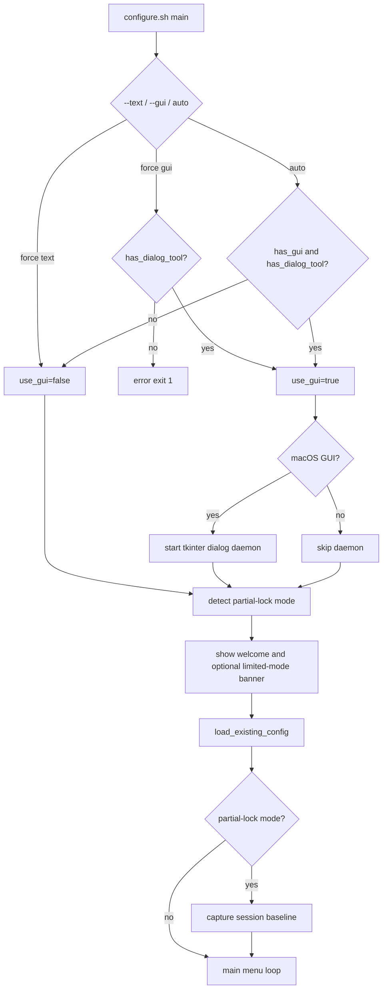
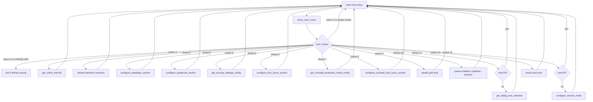
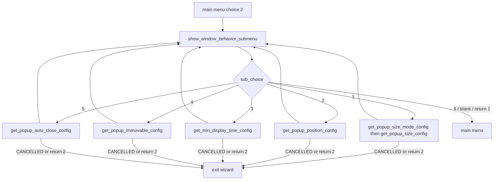
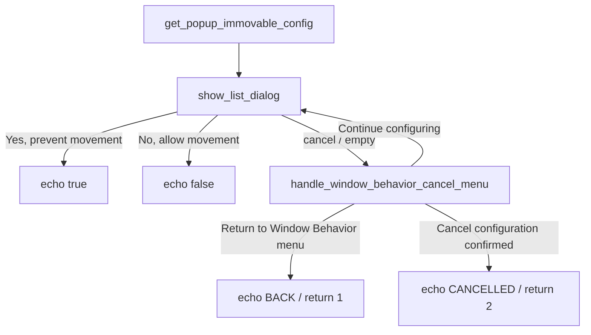
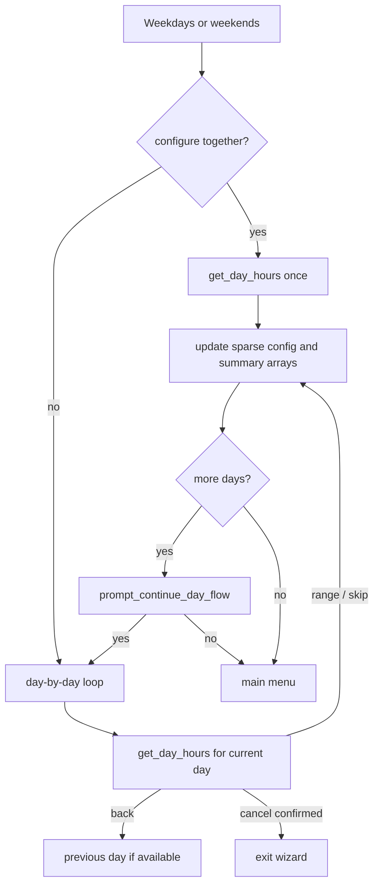
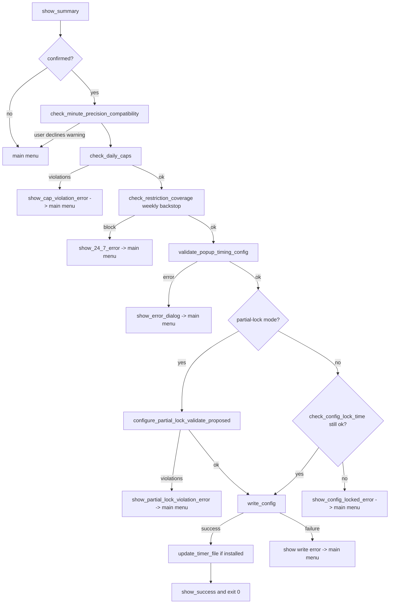

# Configure wizard flow

Current map for `sleep-warning-configure --gui`, `sleep-warning-configure --text`, and
`./configure.sh`. This is a user-visible flow map, not a complete call graph: keep it
focused on dialog transitions, return semantics, and save-time safety gates.

Entry script: `configure.sh` -> `main()`

Platform overlay:

- Linux: `lib/configure-dialogs.sh` plus yad / zenity / kdialog helpers.
- macOS: `lib/configure-dialogs-darwin.sh` and the tkinter daemon override list,
  table, time, and text dialogs where available.

## Startup



Important current behavior:

- `configure.sh` no longer exits just because restriction hours, configure-block
  hours, or config-file lock hours are active. It enters tighten-only partial mode.
- Partial-lock mode is decided near startup and the baseline is captured after config
  load. The same tighten-only rules apply until the wizard exits, even if the clock
  later leaves the locked window.
- Full-mode sessions re-check `check_config_lock_time` before save, so a wizard
  opened during a free window cannot save after crossing into configure-block hours.

## Source Order

`configure.sh` sources facade modules in dependency order. Submodules are sourced by
their facade; do not add every submodule to the entrypoint.

```text
configure-core.sh
config.sh
logging.sh
time-validation.sh
config-locking.sh
platform.sh
display-detection[-darwin].sh
desktop-environment.sh
configure-dialogs.sh
configure-dialogs-darwin.sh       # macOS optional overlay
configure-config.sh               # facade for load/write modules
configure-validation.sh
configure-time.sh
time-calculations.sh
configure-ui.sh                   # facade for UI + error dialogs
configure-input-basic.sh
configure-input-popup.sh
configure-input-features.sh       # facade for security/pause/dialog tool
configure-input-time.sh
configure-input-service.sh
configure-display.sh              # facade for menu/grid/summary
configure-workflow.sh
configure-partial-lock.sh
time-parsing.sh                   # optional
service-config.sh
```

## Main Menu



| # | Menu item | Primary handler | Notes |
|---|-----------|-----------------|-------|
| 1 | Popup display frequency | `get_check_interval` | 1-60 minutes; partial-lock rejects slower frequency. |
| 2 | Window Behavior | `show_window_behavior_submenu` loop | Size, position, min display, immovable, auto-close. |
| 3 | Weekdays Configuration | `configure_weekdays_section` | All weekdays together or day-by-day. |
| 4 | Weekends Configuration | `configure_weekends_section` | Both weekend days together or separately. |
| 5 | Configuration Lock and Config File Locking | `get_security_settings_config` | Combined script-lock and chmod-lock settings. |
| 6 | Additional Configuration Lock Hours | `configure_lock_hours_section` | Counts toward configure-block daily cap. |
| 7 | Uninstall Protection | `get_uninstall_protection_mode_config` | `none` or `difficult`. |
| 8 | Additional Uninstall Protection Hours | `configure_uninstall_lock_hours_section` | Counts toward uninstall-block daily cap. |
| 9 | View Weekly Hours Settings | `show_visual_grid` -> `configure_day_from_grid` | Can edit restriction/configure-lock/uninstall-lock hours by day. |
| 10 | Pause | `get_pause_enabled_config`, cooldown, duration | Partial-lock treats enabling or lengthening pause as loosening. |
| 11 | Dialog Tool Selection | `get_dialog_tool_selection` | Linux only; macOS continues back to menu. |
| 12 | Service Mode Configuration | `configure_service_mode` | Linux only; macOS continues back to menu. |
| 13 | Review and Save | `show_summary` then validators and `write_config` | Only path that writes config. |

Main menu cancel:

- Confirmed exit returns `2` / `CANCELLED` and exits without saving.
- Continue or dismiss returns `1`, which reopens the main menu.
- Empty OK reopens the menu; it does not default to Review and Save.

## Window Behavior Submenu



`BACK` or return code `1` from an item returns to the submenu. `CANCELLED` or return
code `2` exits the wizard.

The immovable prompt is a common path worth preserving:



macOS still saves the setting for config parity, but immovable enforcement is Linux-only.

## Day And Range Editing



`get_day_hours` handles both fresh entry and editing existing ranges:

- Existing ranges open `manage_ranges_dialog` for add/edit/delete/done.
- Fresh ranges use time selection dialogs and "add another" prompts.
- Input-time daily caps are checked before a proposed range is accepted.
- Partial-lock mode allows adding ranges but rejects removing, editing, or clearing
  previously loaded ranges.

Grid path:

```text
Main menu 9
  -> show_visual_grid
  -> day selected
  -> configure_day_from_grid
  -> ask_what_to_edit
  -> restricted hours / configure-lock hours / uninstall-lock hours / all
```

## Review And Save



Save-time invariants:

- `check_daily_caps` is the primary hard block for the 16 h/day per-category cap.
  There is no "save anyway" path.
- `check_restriction_coverage` is retained as a weekly/24-7 backstop.
- `validate_popup_timing_config` prevents minimum display time from exceeding the
  popup frequency window.
- `configure_partial_lock_validate_proposed` enforces the session baseline when the
  wizard started in tighten-only mode.
- `write_config` is the only normal config write path.

## Module Ownership

| File | Role |
|------|------|
| `configure.sh` | Startup, source order, main menu dispatch, save pipeline. |
| `lib/configure-display.sh` | Display facade; sources menu, grid, and summary modules. |
| `lib/configure-display-menu.sh` | `show_main_menu`, `show_window_behavior_submenu`. |
| `lib/configure-display-grid.sh` | Weekly grid display and grid edit selection. |
| `lib/configure-display-summary.sh` | Review summary and save confirmation. |
| `lib/configure-workflow.sh` | Weekday/weekend/grid-day workflows and lock-hour workflows. |
| `lib/configure-input-time.sh` | Interval prompts, `get_day_hours`, input-time cap context. |
| `lib/configure-input-popup.sh` | Window behavior prompts except size details. |
| `lib/configure-input-popup-size.sh` | Size mode and fixed/display-based/custom size prompts. |
| `lib/configure-input-features.sh` | Feature-input facade; sources security, pause, and dialog-tool modules. |
| `lib/configure-input-security.sh` | Configure lock, config lock, uninstall protection. |
| `lib/configure-input-pause.sh` | Pause enabled, cooldown, duration. |
| `lib/configure-input-dialog-tool.sh` | Linux dialog tool selection. |
| `lib/configure-dialogs.sh` | Dialog facade; common dialog APIs and Linux toolkit dispatch. |
| `lib/configure-dialogs-ranges.sh` | Range add/edit/delete workflow. |
| `lib/configure-dialogs-dispatch.sh` | yad/zenity/kdialog multi-column dispatch. |
| `lib/configure-dialogs-darwin.sh` | macOS osascript/tkinter daemon integration. |
| `lib/configure-ui.sh` | Welcome, cancel menus, and UI facade. |
| `lib/configure-ui-errors.sh` | Lock/cap/partial-lock error dialogs. |
| `lib/configure-config.sh` | Config facade plus timer-file update. |
| `lib/configure-config-load.sh` | Existing config loader. |
| `lib/configure-config-write.sh` | Atomic config writer. |
| `lib/configure-partial-lock.sh` | Tighten-only baseline capture and validation. |
| `lib/daily-caps.sh` | Per-day per-category cap math. |
| `lib/configure-validation.sh` | Save-time compatibility, weekly backstop, input-time cap adapter. |

## Maintenance Notes

- Keep this file current when adding menu options, changing cancel/back return
  contracts, or moving configure modules.
- Prefer documenting user-visible state transitions over every helper call.
- If behavior changes touch safety gates, update `docs/SAFETY.md` and this file in
  the same change.
