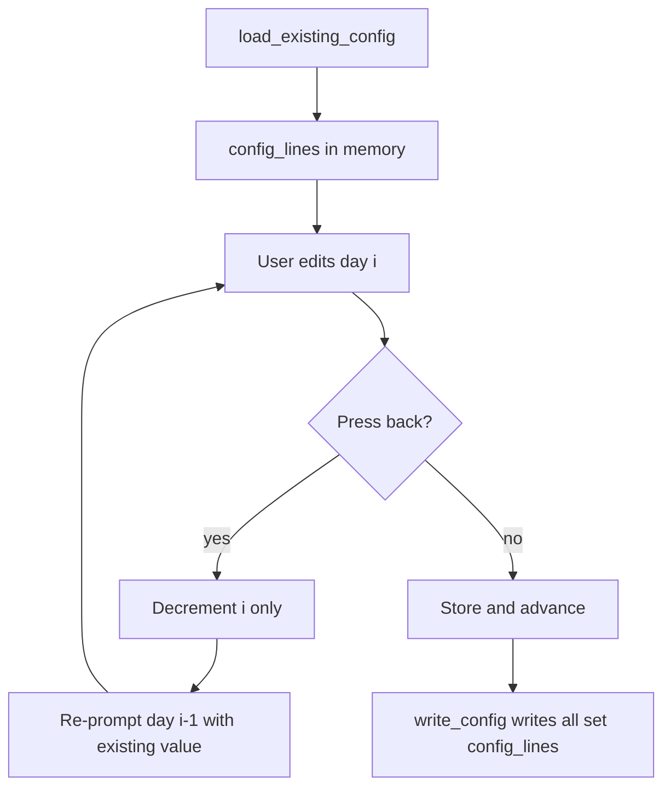

# Plan: Fix configure wizard and validation bugs

## Scope

Fix the **five actionable bugs** from the audit (high/medium/low). **Out of scope** for this pass: AppleScript newline escaping, removing dead `show_high_restriction_warning()`, runtime warnings for malformed on-disk ranges (silent skip in [`lib/daily-caps.sh`](../../lib/daily-caps.sh) — document-only or follow-up).

## Pre-work

- Back up files before edits (per project workflow): [`lib/configure-workflow.sh`](../../lib/configure-workflow.sh), [`lib/time-validation.sh`](../../lib/time-validation.sh), [`lib/time-parsing.sh`](../../lib/time-parsing.sh), [`lib/daily-caps.sh`](../../lib/daily-caps.sh), [`configure.sh`](../../configure.sh), [`lib/uninstall-verification.sh`](../../lib/uninstall-verification.sh) → `backups/`.
- Run verification with `./scripts/run-tests.sh --tier a` plus new targeted tests; `shellcheck -S error` on changed shell files.

---

## 1. HIGH — “Go back” must not drop loaded day restrictions

### Root cause

In [`lib/configure-workflow.sh`](../../lib/configure-workflow.sh), back navigation **decrements the day index then unsets the previous day’s array slot**. [`lib/configure-config-write.sh`](../../lib/configure-config-write.sh) only writes days present in `config_lines[]`; unset entries are omitted → restrictions silently removed on save.

Affected sites (3):

| Flow | Lines | Buggy behavior |
|------|-------|----------------|
| Weekday restrictions | ~111–117 | Back from Tuesday unsets Monday (`config_lines[1]`) |
| Weekend restrictions | ~359–365 | Back from Sunday unsets Saturday (`config_lines[6]`) |
| Configure lock hours (Sun–Sat loop) | ~293–297 | Back unsets previous day’s `lock_hours_lines` |

**Correct pattern already exists** in the same file for lock-hours weekday loop (~264–266) and uninstall lock weekday loop (~639–641): decrement index and `continue` **without** `unset`.

### Fix

Remove the `unset config_lines_ref[…]` / `unset summary_lines_ref[…]` / `unset lock_hours_lines_ref[…]` blocks on back. Keep only index decrement + loop continue so `get_day_hours` re-prompts with `existing_lock` / loaded value intact.



### Test

Add [`tests/test-configure-back-navigation.sh`](../../tests/test-configure-back-navigation.sh) (Tier-A candidate):

- Source workflow + write helpers with temp `HOME`.
- Pre-populate `config_lines[1]=MONDAY=7-23`.
- Simulate back handler logic (or stub `get_day_hours` to return `back` then `skip`) through weekday loop.
- Assert `config_lines[1]` still set after back-from-Tuesday without re-entry.
- Assert `write_config` output still contains `MONDAY=7-23`.
- Mirror one case for `lock_hours_lines` per-day back.

Register in [`tests/tiers.yaml`](../../tests/tiers.yaml) under tier `a` if stable headless.

---

## 2. MEDIUM — Reject zero-length time ranges (all formats)

### Root cause

[`validate_single_range()`](../../lib/time-validation.sh) (integer `7-7`) rejects `start == end`, but [`validate_time_range()`](../../lib/time-validation.sh) calls only [`validate_single_time_range()`](../../lib/time-validation.sh), which accepts `7-7`, `07:00-07:00`, `7am-7am`, etc. Cap math counts **0 minutes**; user believes a restriction exists.

### Fix

Extend `validate_single_time_range()` after part validation:

1. Split `start_part` / `end_part`.
2. Normalize via [`parse_time_token_to_24h_hm()`](../../lib/time-parsing.sh) (already used in [`lib/configure-time.sh`](../../lib/configure-time.sh)).
3. Compare `(start_h * 60 + start_m)` vs `(end_h * 60 + end_m)`; **return 1 if equal** (zero-length window).
4. If `parse_time_token_to_24h_hm` is unavailable (should not happen in production load order), fall back to integer-hour `cut` comparison for `^[0-9]+-[0-9]+$`.

Ensure [`lib/time-validation.sh`](../../lib/time-validation.sh) is sourced after [`lib/time-parsing.sh`](../../lib/time-parsing.sh) in configure/test harness (match existing [`tests/test-16b-core.sh`](../../tests/test-16b-core.sh) sourcing).

### Test

Extend [`tests/test-16b-core.sh`](../../tests/test-16b-core.sh):

- `validate_time_range "7-7"` → invalid
- `validate_time_range "07:00-07:00"` → invalid
- `validate_time_range "7am-7am"` → invalid
- Keep overnight / normal ranges passing

---

## 3. MEDIUM — `set -u` + unset `IFS` crash

### Root cause

`local old_ifs="${IFS}"` / `saved_IFS="${IFS}"` throws `IFS: unbound variable` under `set -u` when `IFS` was unset. Reproduced in [`tests/test-next-unrestricted-hhmm.sh`](../../tests/test-next-unrestricted-hhmm.sh) (test passes but prints error).

### Fix

Replace with safe capture + restore in all four locations:

```bash
local old_ifs="${IFS-}"
# ... use IFS=...
IFS="${old_ifs-}"
```

Default when restoring: `${old_ifs-$' \t\n'}` if empty-unset semantics matter for callers.

Files:

- [`lib/time-parsing.sh`](../../lib/time-parsing.sh) (~271, ~295)
- [`lib/daily-caps.sh`](../../lib/daily-caps.sh) (`_parse_range_to_minute_intervals`)
- Also harden same pattern in [`lib/configure-dialogs-ranges.sh`](../../lib/configure-dialogs-ranges.sh) and [`lib/configure-partial-lock.sh`](../../lib/configure-partial-lock.sh) (same audit class; minimal diff).

### Test

Add small test (e.g. [`tests/test-ifs-set-u.sh`](../../tests/test-ifs-set-u.sh)):

```bash
set -u
unset IFS
# call affected function; expect success, no stderr about unbound IFS
```

Wire into tier `a` if lightweight.

---

## 4. MEDIUM — Save-time `validate_popup_timing_config`

### Root cause

[`validate_popup_timing_config()`](../../lib/configure-validation.sh) runs when editing min-display or frequency ([`lib/configure-input-popup.sh`](../../lib/configure-input-popup.sh), [`lib/configure-input-time.sh`](../../lib/configure-input-time.sh)), but **option 13 (Review and Save)** in [`configure.sh`](../../configure.sh) (~543–612) never calls it before `write_config`. Manual/tampered config + unrelated wizard edits can save an invalid min-display vs frequency pair.

Partial-lock design doc intent: timing should be checked on every save.

### Fix

In [`configure.sh`](../../configure.sh), after cap validation (~574) and before partial-lock / `write_config` (~594):

```bash
if type validate_popup_timing_config >/dev/null 2>&1; then
    timing_error=$(validate_popup_timing_config "${min_display_time}" "${check_interval}" 2>&1)
    if [ $? -ne 0 ]; then
        show_error_dialog "Configuration Error" "${timing_error}"   # same as input-time path
        continue
    fi
fi
```

Use existing `show_error_dialog` pattern from [`lib/configure-input-time.sh`](../../lib/configure-input-time.sh) (~150). Hard block (no override), consistent with cap violations.

### Test

Add [`tests/test-popup-timing-save-validation.sh`](../../tests/test-popup-timing-save-validation.sh):

- Source validation + set `min_display_time=120`, `check_interval=1` (60s interval).
- Assert `validate_popup_timing_config` fails.
- Optional: source configure save-guard logic in isolation if full `configure.sh` menu test is too heavy.

---

## 5. LOW — Uninstall verification EOF spin

### Root cause

[`lib/uninstall-verification.sh`](../../lib/uninstall-verification.sh) uses bare `read -p` at lines ~101, ~397, ~476. Module already documents dependency on [`lib/configure-core.sh`](../../lib/configure-core.sh) for dialogs; `configure_read` is the project-standard EOF-safe reader.

### Fix

Replace three `read -p` calls with `configure_read -p "…" var`.

Handle EOF consistently with configure wizard:

- `verify_confirmation_phrase`: treat empty or `CANCELLED` / exit 2 as cancel (already returns 2 on empty).
- Proceed prompt and arithmetic answer: on EOF, abort verification (return 2 or equivalent cancel path used by callers).

Audit callers in uninstall entry scripts so rc 2 is handled (no infinite loop).

### Test

Extend existing uninstall/configure test or add minimal test: `printf '' | … verify_confirmation_phrase …` must exit quickly (not spin); use `timeout 5`.

---

## 6. Documentation and changelog

- [`CHANGELOG.md`](../../CHANGELOG.md) — `[Unreleased]` entries for each user-visible fix (back navigation data loss, zero-length range rejection, save-time popup timing block, IFS robustness, uninstall EOF safety).
- No change to [`docs/SAFETY.md`](../../docs/SAFETY.md) required unless we document zero-length ranges as explicitly invalid (optional one-line under config validation).

---

## Verification checklist

| Step | Command / action |
|------|------------------|
| ShellCheck | `shellcheck -S error` on all modified `*.sh` |
| Tier-A | `./scripts/run-tests.sh --tier a` |
| New tests | back-navigation, zero-length, IFS set -u, popup timing save |
| Security | `./scripts/run-security-scan.sh --ci` if `lib/` or entry scripts changed |
| Manual smoke | Temp `HOME`: load config with Monday set → weekday flow → back from Tuesday → save without re-entering Monday → confirm `MONDAY=` still in file |

---

## Implementation order

1. Back-navigation fix + test (highest user impact)
2. Zero-length range validation + test
3. IFS `set -u` hardening + test
4. Save-time popup timing + test
5. Uninstall `configure_read` + test
6. CHANGELOG + tier manifest updates


