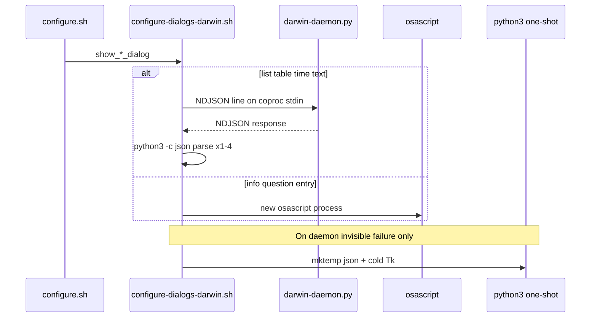

# macOS configure GUI responsiveness deep-dive

## Current architecture (what you have today)

The wizard is one long-lived **bash** process ([`configure.sh`](../../configure.sh)) that calls dialog helpers overridden on macOS by [`lib/configure-dialogs-darwin.sh`](../../lib/configure-dialogs-darwin.sh).



| Layer | Mechanism | Status |
|-------|-----------|--------|
| Dialog detection | Session cache in [`lib/configure-core.sh`](../../lib/configure-core.sh); Darwin skips X11/Wayland via early `osascript` path | **Shipped** (Phase 1) |
| Weekly grid labels | [`_configure_build_grid_cache`](../../lib/configure-display.sh) + `configure_invalidate_grid_cache` | **Shipped** (Phase 2) |
| Tk cold start | [`configure-dialogs-darwin-daemon.py`](../../lib/configure-dialogs-darwin-daemon.py) + eager start in `configure.sh` ~L262–265 | **Shipped** (Phase 3) |
| Menus / confirms | `show_list_dialog` → daemon `list` op (not per-prompt osascript) | **Shipped** (recent) |
| Profiling | `CONFIGURE_PROFILE=1` → `prep_ms` / `ui_ms` for **table, time, text** only | **Partial** |
| osascript `activate` throttle | Phase 4 in [`configure_gui_responsiveness_facddfc8.plan.md`](configure_gui_responsiveness_facddfc8.plan.md) | **Implemented** (conditional `activate` shipped; manual z-order QA open — see TO_DO smoke tests) |

Reference doc: [`dev-docs/architecture/configure-flow.md`](../architecture/configure-flow.md) (§ macOS performance).

---

## Where latency still comes from (ranked)

### 1. Per-dialog work after optimizations (largest remaining wins)

| Cost | Where | Typical when felt |
|------|--------|-------------------|
| **Table JSON rebuild + array copy** | `show_visual_grid` copies the cached `_CONFIGURE_GRID_*` arrays into `grid_data[]` on every loop iteration, then [`_cd_darwin_build_table_json`](../../lib/configure-dialogs-darwin.sh) escapes ~32 cells via pure-bash string ops (no subprocess, but O(N×columns) per show) | Every return to weekly grid (option 9), even when the grid cache arrays are warm — **the JSON string itself is not cached** |
| **4× `python3 -c` per daemon response** | `_cd_darwin_response_was_shown`, `_is_ok`, `_is_cancelled`, `_cd_darwin_response_extract_value` — always all 4, plus one extra `python3 -c` ready-check at daemon startup | Every list/table/time/text interaction |
| **Full Toplevel rebuild** | Daemon creates new `Toplevel`, builds Treeview/Listbox from scratch; `run_modal()` calls `deiconify/lift/grab_set`; [`apply_initial_frontmost`](../../lib/configure_dialogs_darwin_window.py) acts on the hidden `tk.Tk` root, not the Toplevel directly | Every tk dialog (expected; pooling is hard) |
| **Focus grace delays** | `_GRACE_MS = 400`, `after(50)`, `after_idle` re-raise | Every tk dialog open (~400ms+ of intentional deferral) |

Grid string cache **does not** cache serialization:

```693:735:lib/configure-display.sh
            _configure_build_grid_cache summary_lines_ref lock_hours_lines_ref uninstall_lock_hours_lines_ref
            ...
            local grid_data=()
            for i in "${!day_names[@]}"; do
                grid_data+=(...)
            done
            selected=$(show_multi_column_list_dialog ... "${grid_data[@]}")
```

### 2. Daemon lifecycle timing

Daemon starts **after** welcome + `load_existing_config()` ([`configure.sh`](../../configure.sh) L223–265), not at GUI detection. First tk dialog (main menu if list path, or grid) still pays **Python import + `tk.Tk()`** unless the user dismissed welcome slowly enough.

Welcome itself uses **osascript** `show_info_dialog` — a good window to **overlap** daemon startup with user reading.

### 3. osascript paths (still used)

| Dialog | Backend |
|--------|---------|
| Welcome, many info/error prompts | osascript `display alert` — **`activate` every call** |
| Entry prompts | osascript `display dialog` |
| List fallback | `choose from list` when daemon never maps (`shown=false`) |

Phase 4 (conditional `activate`) was explicitly deferred because z-order regressions on macOS 13+ are documented ([`lib/configure-ui.sh`](../../lib/configure-ui.sh) `confirm_cancel` → list for that reason).

### 4. Fallback paths (correctness > speed)

- Table: daemon invisible failure → one-shot [`configure-dialogs-darwin-table.py`](../../lib/configure-dialogs-darwin-table.py) (full cold Tk) — **must keep**
- `CONFIGURE_DARWIN_NO_DAEMON=1` — test/diagnostic bypass
- `daemon_shown` / `was_shown` logic prevents duplicate windows — **do not simplify away**

### 5. Small / micro costs

- Time dialog prep: six `cut` pipelines in `_cd_darwin_show_time_dialog` before JSON
- Daemon imports all four `*_ui` modules at startup ([`configure-dialogs-darwin-daemon.py`](../../lib/configure-dialogs-darwin-daemon.py) L25–28)
- `has_dialog_tool` still invoked at many `configure-display.sh` gates (cached after first call — low cost)

---

## What is intentionally **not** broken for speed

From [`docs/SAFETY.md`](../../docs/SAFETY.md) and project history — **do not trade these for responsiveness**:

- Per-day 16h caps / validation paths unchanged
- `shown` flag + one-shot table fallback (blank/invisible window regressions)
- `apply_initial_frontmost` / non-persistent topmost after grace
- `confirm_cancel` / `show_confirm_dialog` list-based z-order workarounds
- Combined summary+save tk path (avoids osascript-after-tk failure)
- 600s daemon `read` timeout (user think time, not overhead)

---

## Recommended optimization roadmap (priority = impact ÷ risk)

### Tier A — Safe, mechanical (do first)

**A1. Single-pass daemon response parsing**

Replace 4 separate `python3 -c` invocations (always all four per interaction) with a `_cd_darwin_parse_last_response` helper that sets globals `_CD_RESP_OK`, `_CD_RESP_VALUE`, `_CD_RESP_CANCELLED`, `_CD_RESP_SHOWN`.

Recommended **hybrid approach**: pure-bash regex for the three boolean fields (`ok`, `cancelled`, `shown`) — zero subprocess cost — and a single `python3 -c` call only when the value field is needed (handles embedded quotes and unicode safely). This cuts 4 spawns to 0–1 per interaction.

As a bonus, replace the daemon ready-check at startup (`_cd_darwin_daemon_start` L218: `python3 -c 'import json,sys; ...'`) with the same bash check — one less subprocess on wizard open.

- Files: [`lib/configure-dialogs-darwin.sh`](../../lib/configure-dialogs-darwin.sh)
- Risk: **Low** — pure refactor; extend [`tests/test-darwin-daemon-protocol.sh`](../../tests/test-darwin-daemon-protocol.sh) with a bash-level parse smoke test
- Expected: **~30–120 ms** per tk interaction (4 process spawns × ~10–30 ms each on Apple Silicon; measure with `CONFIGURE_PROFILE=1`)

**A2. Cache table JSON with grid cache**

When `_configure_build_grid_cache` runs, also build and store `_CONFIGURE_GRID_TABLE_JSON` (fixed title/message/width/height/columns; rows from cached arrays). Invalidate only via existing `configure_invalidate_grid_cache`.

Two-part win:
1. **Cache the JSON string** in `_configure_build_grid_cache` — skips the `_cd_darwin_build_table_json` bash loop (pure-bash string ops over ~32 cells) on repeated grid shows
2. **Skip the `grid_data[]` array copy** in `show_visual_grid` — when the JSON is pre-built, `_cd_darwin_show_table_dialog` can accept it directly, bypassing the per-show bash loop at L706–712

- Files: [`lib/configure-display.sh`](../../lib/configure-display.sh), [`lib/configure-core.sh`](../../lib/configure-core.sh) (add `_CONFIGURE_GRID_TABLE_JSON` global), [`lib/configure-dialogs-darwin.sh`](../../lib/configure-dialogs-darwin.sh) — `_cd_darwin_show_table_dialog` accepts optional prebuilt JSON
- Risk: **Low** if invalidation stays tied to `configure_hours_data_changed` / lock/uninstall mutations
- Expected: **50–150 ms** on repeated grid opens; biggest win when hopping grid → edit day → grid

**A3. Overlap daemon startup with welcome**

Move `_cd_darwin_daemon_start` to immediately after `use_gui` is determined (~L215 in `configure.sh`, right after the `if/elif/else` GUI-detection block and **before** the `show_welcome` call at L224). This maximises the cold-start overlap window — the user reads the welcome alert while Python and tkinter initialise.

The lib is already sourced before this point (`source_optional_lib "configure-dialogs-darwin.sh"` at L99), and `is_darwin` is already confirmed by that guard. No ordering constraints to work around.

- Files: [`configure.sh`](../../configure.sh) — move the `_cd_darwin_daemon_start` block from ~L262 to ~L215
- Risk: **Low** — same daemon, earlier start; failure still `|| true`
- Expected: **First tk dialog** feels as fast as later ones (200–800 ms cold start absorbed during welcome)

**A4. Extend profiling coverage**

Add `_cd_darwin_profile_log` to `show_list_dialog` (currently unhooked) and optionally osascript wrappers (`prep_ms` = JSON/build, `ui_ms` = osascript block). Also add a profile log line on the silent daemon→osascript fallback path in `show_list_dialog` (when `shown=false`) — this makes invisible-daemon failures observable in the field without adding noise to normal runs.

- Risk: **None** (stderr only when `CONFIGURE_PROFILE=1`)

**A5. Micro: time JSON prep in bash**

Replace six `echo … | cut` calls with a small bash parser or single `read` from `parse_normalized_time_to_12h` output — minor, only worth doing while touching time dialog code.

---

### Tier B — Measurable UX, needs macOS manual QA

**B1. Phase 4 — conditional osascript `activate`**

Track `_CD_LAST_DIALOG_END_MS`; skip `tell current application to activate` only when:
- Last dialog was osascript (not tkinter), and
- Elapsed &lt; ~500 ms, and
- Not the first dialog in session

Always activate after any tkinter dialog and before `choose from list` fallback.

- Risk: **Medium** — z-order regressions on macOS 13+; requires manual matrix (terminal behind dialog)
- Expected: **Tens of ms** per rapid info/alert chain; little benefit if menus are already tk daemon

**B2. Tune focus grace (careful)**

Profile whether `_GRACE_MS=400` can drop to 200–250 ms without FocusOut flapping. Requires interactive testing on target macOS versions; keep `after_idle` raise.

- Risk: **Medium–high** for “dialog behind terminal” reports
- Do **not** remove topmost-on-open entirely

**B3. Lazy-import UI modules in daemon**

Import `table_ui` / `list_ui` / etc. inside `_run_dialog` per `op` to shrink initial `python3` import time (helps A3 overlap less if welcome is skipped).

- Risk: **Low**; small cold-start win (~50–200 ms)

---

### Tier C — Defer unless profiling proves need

| Idea | Why defer |
|------|-----------|
| Reuse/pool Toplevel widgets | High complexity; `cleanup_modal_window` exists for reuse but full rebuild is simpler; easy to leak state |
| Replace coproc with socket/HTTP | No proven bottleneck; coproc is fine for NDJSON |
| Native Swift/AppKit configure UI | Out of scope; largest rewrite |
| Drop table one-shot fallback | Breaks invisible-daemon case on macOS |
| Parallel bash for grid formatting | Grid cache already covers hot path |

---

## Verification strategy (no behavior regressions)

| Check | Command / method |
|-------|------------------|
| Headless regressions | `bash tests/test-darwin-configure-gui.sh` (daemon protocol, modal static checks) |
| Grid cache (A2) | `bash tests/test-darwin-grid-cache.sh` — dedicated grid cache invalidation tests |
| Table JSON (A2) | `bash tests/test-darwin-table-json.sh` — dedicated table JSON build tests |
| Daemon protocol (A1) | `bash tests/test-darwin-daemon-protocol.sh` — extend with bash-level parse smoke test for A1 |
| Partial lock / caps | `bash tests/test-configure-partial-lock.sh`, `bash tests/test-daily-caps.sh` if touching display/core |
| Before/after timing | `CONFIGURE_PROFILE=1 ./configure.sh` — compare `prep_ms` (should drop for grid/list) and `ui_ms` (should stay dominated by user + Tk map) |
| Manual macOS matrix | Main menu ↔ window behavior ↔ weekly grid ↔ time editor ↔ summary save; terminal focused vs IDE; cancel/Back/Escape; confirm after list |
| Daemon mid-session death | Kill the daemon PID mid-session (`kill $pid`); verify next dialog falls back cleanly (table→one-shot, list→osascript `choose from list`) without duplicate windows |
| Z-order regression | `confirm_cancel`, osascript after tk (should still use list/tk paths), invisible daemon → osascript list fallback |
| CI | `./scripts/run-security-scan.sh --ci --with-tests` after `lib/` changes |
| Safety | No changes to [`lib/configure-validation.sh`](../../lib/configure-validation.sh), [`lib/popup-safety.sh`](../../lib/popup-safety.sh), or popup spawn paths |

**No automated perf regression exists today** — add optional threshold test only if you want CI guardrails (e.g. `prep_ms < 200` for cached grid in a synthetic harness); otherwise keep profiling manual.

---

## Suggested implementation order

1. **A1 + A4** — measure and reduce per-response overhead; improve observability  
2. **A2** — cache table JSON with grid invalidation  
3. **A3** — early daemon warm during welcome  
4. **B1** — only if profiling shows osascript still dominates 2-column flows  
5. **B2/B3** — only with explicit manual sign-off on z-order and cold start  

---

## Documentation / changelog

For any shipped tier-A/B work:

- Update [`dev-docs/architecture/configure-flow.md`](../architecture/configure-flow.md) performance table  
- [`CHANGELOG.md`](../../CHANGELOG.md) under `[Unreleased]` → Performance
- Brief note in [`user-docs/MACOS.md`](../../user-docs/MACOS.md) only if user-visible (e.g. “wizard opens faster”) — optional

---

## Bottom line

You have already captured the **largest** win (long-lived tkinter daemon + grid label cache). Remaining responsiveness is mostly:

1. **Bash work per screen** (table JSON serialization on every grid show),  
2. **Post-dialog parsing tax** (multiple Python one-liners),  
3. **First-session daemon cold start timing**, and  
4. **Intentional focus delays + osascript process spawn** on non-tk paths.

Tier A changes target (1)–(3) with low regression risk. Tier B needs manual z-order validation. Tier C is unlikely to pay off relative to complexity.
