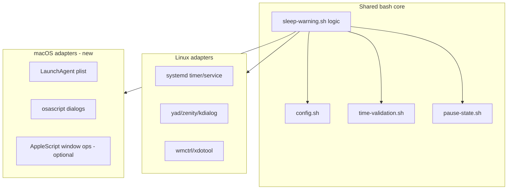
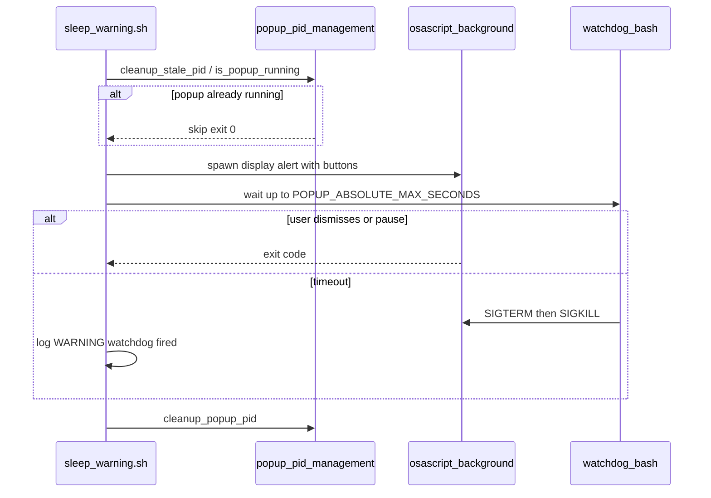

# macOS Support Plan

## Current state

The project is **Linux-first** end to end:

- **Scheduling:** systemd user timer ([`sleep-warning.timer`](../../sleep-warning.timer)) + oneshot service ([`sleep-warning.service`](../../sleep-warning.service))
- **Install:** [`install.sh`](../../install.sh) requires `/etc/os-release`, `systemctl`, and a Linux package manager
- **Popups:** yad / zenity / kdialog via [`lib/popup-dialog-implementations.sh`](../../lib/popup-dialog-implementations.sh)
- **Windows:** wmctrl / xdotool via [`lib/window-management.sh`](../../lib/window-management.sh)
- **Display:** X11/Wayland/gamescope via [`lib/display-detection.sh`](../../lib/display-detection.sh)

**Already portable (reuse as-is):** [`lib/time-parsing.sh`](../../lib/time-parsing.sh), [`lib/time-validation.sh`](../../lib/time-validation.sh), [`lib/config.sh`](../../lib/config.sh), [`lib/pause-state.sh`](../../lib/pause-state.sh), [`lib/configure-validation.sh`](../../lib/configure-validation.sh), most of [`sleep-warning.sh`](../../sleep-warning.sh) orchestration after platform hooks.



---

## Recommended approach: phased delivery

Use **four phases**. Phase 1 is shippable on your Mac; safety guardrails are mandatory in Phase 1, not deferred.

| Phase | Goal | User-visible outcome |
|-------|------|----------------------|
| **1 – MVP** | Reliable, **safe** scheduled warnings | Install, launchd timer, osascript popup **with pause**, text configure, manage/status/uninstall, safety watchdogs |
| **2 – GUI (subset)** | GUI for **timer + hours only** | `configure.sh --gui` limited menu: check interval, weekdays/weekends hours, review/save; rest stays text-only or hidden |
| **3 – Advanced UX** | Power-user popup behavior | Position/size (where feasible), resume grace, optional stay-on-top/immovable with TCC |
| **4 – Full GUI parity** | Remaining configure wizard in GUI | Security, pause settings, visual grid, window behavior, etc. per [Phase 4 appendix](#phase-4-appendix-configure-dialog-inventory) |

**Out of scope on macOS (document, do not implement):** SteamOS gaming mode, Wayland/gamescope, systemd drop-ins, `wmctrl`/`xdotool`, `journalctl` integration.

### Locked decisions (user-confirmed)

| Decision | Choice |
|----------|--------|
| Pause in warning popup | **Required in Phase 1 MVP** — `display alert` with OK + "Pause N min" (uses portable `pause-state.sh`) |
| Phase 2 GUI scope | **Timer + restricted hours only**; full wizard GUI deferred to Phase 4 |
| Safety | **Non-negotiable:** no stuck all-day modal; hard timeouts, auto-close defaults, 24/7 configure block, emergency stop documented |
| Phase 2 appendix + troubleshooting | **Include in plan:** dialog inventory below; `user-docs/MACOS.md` troubleshooting playbook |

### Remaining technical defaults (pre-implementation)

| Decision | Recommendation | Why |
|----------|----------------|-----|
| `POPUP_MIN_DISPLAY_TIME` on darwin | **Background osascript + bash watchdog** — never unbounded blocking in `sleep-warning.sh` | Prevents launchd overlap and “stuck script” if dialog hangs |
| `service-config.sh` refactor | **Facade pattern** | Single `update_timer_file()` entry point |
| Minimum macOS version | **macOS 13 (Ventura)+** | Modern `launchctl bootstrap gui/$UID` |
| Repo/product naming | **Keep "Linux Sleep Warning"**; note macOS in README | Renaming optional later |
| `service-config.sh` refactor | **Facade pattern:** keep `lib/service-config.sh` as dispatcher; move Linux body to `service-config-linux.sh` | Avoids breaking existing `source` paths; single `update_timer_file()` entry point |
| Minimum macOS version | **macOS 13 (Ventura)+** for `launchctl bootstrap gui/$UID` | Document Ventura/Sonoma/Sequoia manual smoke test; avoid pre-Ventura `launchctl load` |
| Repo/product naming | **Keep "Linux Sleep Warning" name**; subtitle "also supports macOS" in README | Renaming repo is optional follow-up, not blocking |

---

## Architecture: platform abstraction layer

### 1. Central platform detection

Add [`lib/platform.sh`](../../lib/platform.sh):

```bash
detect_platform()   # echoes: linux | darwin
is_linux() / is_darwin()
get_init_system()   # systemd | launchd
```

Use `uname -s` (`Darwin` vs `Linux`). **Do not** use `/etc/os-release` on macOS.

Extend [`lib/library-loader.sh`](../../lib/library-loader.sh) with helpers:

- `source_platform_lib "service-config"` → loads `service-config.sh` or `service-config-darwin.sh`
- Or: `lib/platform/linux/*.sh` and `lib/platform/darwin/*.sh` with thin facades

**Convention:** shared modules stay in `lib/`; platform-specific implementations use suffix `-darwin.sh` / `-linux.sh` or live under `lib/platform/{linux,darwin}/`.

### 2. Init system adapter (systemd vs launchd)

| Concern | Linux ([`lib/service-config.sh`](../../lib/service-config.sh), [`install.sh`](../../install.sh)) | macOS (new) |
|---------|--------------------------------------------------------------------------------------|-------------|
| Timer install path | `~/.config/systemd/user/` | `~/Library/LaunchAgents/com.sleep-warning.plist` |
| Enable/start | `systemctl --user enable/start` | `launchctl bootstrap gui/$UID ~/Library/LaunchAgents/...` then `launchctl kickstart -k gui/$UID/com.sleep-warning` |
| Interval from `CHECK_INTERVAL` | `OnCalendar=*:0/N` | `StartInterval` = N * 60 (seconds) |
| Logs | `journalctl --user` | File log only ([`lib/logging.sh`](../../lib/logging.sh)) + optional `log show` note in docs |
| Uninstall | remove `.service`/`.timer` | `launchctl bootout gui/$UID/com.sleep-warning` + remove plist |
| Runs when logged out? | `loginctl enable-linger` optional on Linux | **No** — user LaunchAgents run only while user session is active; document in MACOS.md |

**Structural difference:** Linux uses a **timer unit** that triggers a **oneshot service** ([`sleep-warning.service`](../../sleep-warning.service) runs the script once per tick). macOS uses a **single LaunchAgent** whose `ProgramArguments` invoke `sleep-warning.sh` directly on each `StartInterval` tick — no separate service file.

**Plist label:** use `com.sleep-warning` consistently (matches Linux unit naming intent).

**Regenerating interval:** `update_timer_file()` on darwin rewrites plist `StartInterval` and runs `launchctl bootout` + `bootstrap` (or `kickstart` after plist replace) — mirror [`lib/configure-config.sh`](../../lib/configure-config.sh) `update_timer_file()` (~line 294) which today only writes systemd timer.

New files:

- [`launchd/com.sleep-warning.plist.template`](../../launchd/com.sleep-warning.plist.template) — `ProgramArguments`, `StartInterval`, `RunAtLoad=false`, `StandardOutPath`/`StandardErrorPath` under `~/.config/sleep-warning/logs/`
- [`lib/service-config-darwin.sh`](../../lib/service-config-darwin.sh) — `install_launch_agent()`, `update_timer_interval()`, `remove_launch_agent()`
- Refactor [`lib/configure-config.sh`](../../lib/configure-config.sh) `update_timer_file()` to call platform adapter instead of hardcoding systemd

**manage.sh / status.sh / uninstall.sh:** branch on `is_darwin()` — replace `systemctl`/`journalctl` strings with launchctl equivalents; keep shared config display logic.

### 3. Dialog adapter (GTK vs osascript)

| Linux | macOS |
|-------|-------|
| `check_dialog_tool()` in [`lib/desktop-environment.sh`](../../lib/desktop-environment.sh) | `check_dialog_tool_darwin()` → `osascript` (always present) |
| `_popup_spawn_warning_dialog()` | `_popup_spawn_warning_dialog_darwin()` using `display alert` / `display dialog` |
| Configure `show_*_dialog()` in [`lib/configure-dialogs.sh`](../../lib/configure-dialogs.sh) | Phase 2: `configure-dialogs-darwin.sh` with list/entry/question wrappers |

**MVP warning popup (Phase 1):**

- Modal `display alert` with **OK** and **Pause N min** (Enhancement #21 — required)
- Spawn osascript **in background**; parent enforces **hard watchdog** (see [Safety guardrails](#safety-guardrails-critical))
- `notify-send` fallback → `display notification` via osascript when modal path fails
- **Do not** run a single foreground `osascript` with `delay 300` in the main script without a kill timer

**Limitations to document in README:**

- No live countdown relabel in dialog (static message text on darwin Phase 1)
- `DIALOG_TOOL` ignored on darwin (`osascript` only)

### 4. Display and window adapters

| Module | Phase 1 | Phase 3 |
|--------|---------|---------|
| [`lib/display-detection.sh`](../../lib/display-detection.sh) | `display-detection-darwin.sh`: assume GUI if `osascript` works and session is console user | — |
| [`lib/resolution-detection.sh`](../../lib/resolution-detection.sh) | `system_profiler SPDisplaysDataType` or AppleScript screen bounds for popup sizing | — |
| [`lib/window-management.sh`](../../lib/window-management.sh) | **No-op stubs** on darwin (popups still show; no stay-on-top/immovable) | `window-management-darwin.sh` via System Events — requires **Accessibility** permission; document TCC prompt |

[`lib/popup-display.sh`](../../lib/popup-display.sh): at top, `source_platform_lib` for display + dialog + window; guard Linux-only branches (gamescope, `DISPLAY` forcing).

### 5. Sleep-resume grace ([`lib/sleep-detection.sh`](../../lib/sleep-detection.sh))

- Linux: keep `systemctl show` + `/proc/uptime`
- Darwin: use `sysctl kern.boottime` and/or compare `sysctl kern.boottime` / last wake — **or** skip grace on MVP and log “macOS: resume grace not yet implemented”
- Existing `date -r` fallback in sleep-detection is already mac-friendly for timestamp parsing

### 6. Config locking ([`lib/config-locking.sh`](../../lib/config-locking.sh))

- `stat -c` vs `stat -f` fallbacks already partially exist — verify all `chmod`/`stat` paths use portable helpers
- Lock behavior (read-only config dir during restricted hours) should work on APFS; add darwin-specific tests in [`tests/test-config-locking.sh`](../../tests/test-config-locking.sh)
- **Uninstall protection** ([`lib/uninstall-verification.sh`](../../lib/uninstall-verification.sh), Enhancement #26): portable — same Q&A flow on darwin; no platform branch needed

### 7. Config keys: behavior by phase on macOS

| Config key / feature | Phase 1 (MVP) | Phase 2+ |
|---------------------|---------------|----------|
| Restricted hours, lock hours, uninstall lock | Full (shared logic) | — |
| `CHECK_INTERVAL` | Updates LaunchAgent `StartInterval` | — |
| `PAUSE_*` | Simplified osascript buttons | — |
| `POPUP_MIN_DISPLAY_TIME` | Capped + watchdog (max 60s darwin MVP default cap) | Phase 3 live countdown optional |
| `POPUP_AUTO_CLOSE` | **Forced true** on darwin MVP (config may not disable) | Phase 4 allow user toggle if safe |
| `POPUP_POSITION`, `POPUP_SIZE*`, `POPUP_IMMOVABLE` | **Ignored** (document) | Phase 3 partial |
| `DIALOG_TOOL` | Hidden / ignored (`osascript` only) | — |
| Service mode / gaming drop-ins | Hidden | N/A |
| [`popup-pid-management.sh`](../../lib/popup-pid-management.sh) dedup | **Keep** — same PID file logic | — |

### 8. Installer

**Unified [`install.sh`](../../install.sh)** (recommended):

```
detect_platform
  ├─ linux  → existing flow (unchanged behavior)
  └─ darwin → install_darwin()
        ├─ check bash, osascript
        ├─ skip apt/dnf/os-release
        ├─ same paths: ~/.local/bin, ~/.local/lib/sleep-warning, ~/.config/sleep-warning
        ├─ PATH in ~/.zprofile (and ~/.bashrc if present)
        ├─ install LaunchAgent plist
        └─ launchctl bootstrap + kickstart
```

Optional later: Homebrew formula — **not** required for Phase 1.

**configure.sh menu on darwin:**

- **Phase 1:** text mode for all items; hide service mode + dialog tool
- **Phase 2:** enable `--gui` for menu items **1, 3, 4, 13** only (timer, weekdays, weekends, review/save); items 2, 5–12 remain text-only or “use `--text`” message
- **Phase 4:** remaining menu items per appendix

---

## Safety guardrails (critical)

**Design principle:** A scheduled check must **always finish** within a bounded time. The user must **never** be trapped by a modal that survives indefinitely or stacks every `CHECK_INTERVAL` until the desktop is unusable.

### Threat model

| Failure mode | How it could happen | Guardrail |
|--------------|---------------------|-----------|
| Modal open all day | `POPUP_AUTO_CLOSE=false` + user away from keyboard | Darwin MVP: **force** `POPUP_AUTO_CLOSE=true`; watchdog kills dialog anyway |
| Script hung forever | Blocking `osascript` / AppleScript `delay` in foreground | Background spawn + **`POPUP_ABSOLUTE_MAX_SECONDS`** watchdog (parent kills PID) |
| Stacked modals | launchd fires again while previous dialog still open | Reuse [`popup-pid-management.sh`](../../lib/popup-pid-management.sh): skip new popup if PID alive; stale PID cleanup |
| Warnings 24/7 | Misconfigured hours covering entire week | **Save-time:** `check_restriction_coverage` → `block` in configure (existing). **Runtime:** `sleep-warning.sh` falls back to `DEFAULT_HOURS` if `block` detected (existing) |
| Cannot change config to fix | Locked during restricted hours | Existing configure block + lock hours; document `--text` from unrestricted time or `manage` disable timer |
| Cannot uninstall | Uninstall lock / running timer | `manage.sh` disable timer; emergency commands in MACOS.md; uninstall verification unchanged |

### New module: `lib/popup-safety.sh` (shared + darwin hooks)

Constants (darwin may override via `platform.sh`):

- `POPUP_ABSOLUTE_MAX_SECONDS` — hard ceiling per invocation (recommend **120** on darwin MVP even if `POPUP_MIN_DISPLAY_TIME` + auto-close math is lower)
- `DARWIN_MAX_MIN_DISPLAY_TIME` — cap enforced at read time (recommend **60** on MVP; Linux keeps 300 from [`lib/config.sh`](../../lib/config.sh))
- `DARWIN_FORCE_AUTO_CLOSE` — `true` on MVP

Functions:

- `popup_compute_watchdog_seconds(min_display, auto_close)` → `min(absolute_max, min_display + auto_close_delay + buffer)`
- `popup_run_with_watchdog(spawn_fn, watchdog_seconds)` → spawn, wait with timeout, `kill -TERM` then `kill -KILL`, log outcome
- `popup_assert_safe_config()` — called at start of `show_warning` on darwin: clamp min display, force auto-close

### Darwin popup flow (Phase 1)



### Reuse existing Linux safety (no regression)

- [`check_restriction_coverage()`](../../lib/configure-validation.sh) — blocks saving 24/7 config (`block` / `warn`)
- [`validate_config_safety()`](../../sleep-warning.sh) — runtime fallback to defaults on `block`
- [`get_min_display_time()`](../../lib/config.sh) — clamp to `MAX_DISPLAY_TIME` (300 on Linux); darwin adds lower cap in `popup_assert_safe_config`
- [`auto_close_popup()`](../../lib/popup-display.sh) — keep on Linux; on darwin integrate into watchdog timing instead of unbounded wait

### Install-time safety (darwin)

- Default new install config: `POPUP_AUTO_CLOSE=true`, `POPUP_MIN_DISPLAY_TIME=30` (or lower cap 30)
- Post-install message: how to **disable timer immediately** (`sleep-warning-manage` or `launchctl bootout`)
- `install.sh` does **not** set restricted hours to 24/7

### Tests (Phase 1)

- `tests/test-popup-safety-darwin.sh`: watchdog kills hung mock spawn; skips second popup when PID file present; `popup_compute_watchdog_seconds` edge cases
- Extend/configure tests: 24/7 `block` still prevents write on darwin temp HOME

### Emergency user playbook (in `user-docs/MACOS.md`)

Document verbatim recovery steps:

1. **Stop scheduled checks:** `launchctl bootout gui/$(id -u)/com.sleep-warning` or Manage → Disable
2. **Close stuck dialog:** `killall osascript` (only affects Script Editor dialogs — note in doc)
3. **Edit config outside restricted hours:** `sleep-warning-configure --text` or edit `~/.config/sleep-warning/config/sleep-warning.conf`
4. **Uninstall:** `sleep-warning-uninstall`

---

## Phase 2: GUI scope (timer + hours only)

**Enabled in Phase 2 (`configure.sh --gui` on darwin):**

| Menu # | Feature | Dialogs needed |
|--------|---------|----------------|
| 1 | `CHECK_INTERVAL` | `show_entry_dialog` |
| 3 | Weekdays hours | `show_time_selection_dialog` + validation errors |
| 4 | Weekends hours | same as weekdays |
| 13 | Review & Save | `show_question_dialog` / `show_info_dialog` + 24/7 block error |

**Deferred to Phase 4 (text-only or stub in Phase 2):** 2 (window behavior), 5–12 (security, grid, pause config, dialog tool, service mode), uninstall lock subflows beyond save.

**Phase 2 deliverables:**

- Minimal `configure-dialogs-darwin.sh`: `show_info_dialog`, `show_error_dialog`, `show_question_dialog`, `show_entry_dialog`, `show_time_selection_dialog` (can wrap `show_entry_dialog` initially)
- `configure.sh` darwin branch: reduced `show_main_menu` with only items 1, 3, 4, 13 (+ Exit)
- Save path still runs full `check_restriction_coverage` / safety overrides

---

## Phase 4 appendix: configure dialog inventory

Full parity checklist for Phase 4 (source: [`lib/configure-dialogs.sh`](../../lib/configure-dialogs.sh), [`lib/configure-dialogs-time.sh`](../../lib/configure-dialogs-time.sh), consumers in `configure-input-*.sh`, `configure-ui.sh`, `configure-display.sh`).

### Core primitives (implement first in Phase 2 subset)

| Function | File | Phase 2 | Phase 4 |
|----------|------|---------|---------|
| `show_info_dialog` | configure-dialogs.sh | Yes | — |
| `show_error_dialog` | configure-dialogs.sh | Yes | — |
| `show_question_dialog` | configure-dialogs.sh | Yes | — |
| `show_entry_dialog` | configure-dialogs.sh | Yes | — |
| `show_list_dialog` | configure-dialogs.sh | — | Yes |
| `show_text_info_dialog` | configure-dialogs.sh | — | Yes |
| `show_multi_column_list_dialog` | configure-dialogs.sh | — | Yes |
| `show_time_selection_dialog` | configure-dialogs-time.sh | Yes (entry fallback OK) | Full yad-like UX optional |
| `show_time_selection_dialog_yad/zenity/kdialog` | configure-dialogs-time.sh | N/A darwin | N/A |

### Composite / workflow (Phase 4)

| Function / flow | Used by menu | Phase |
|-----------------|--------------|-------|
| `manage_ranges_dialog` | Visual grid / range edit | 4 |
| `show_main_menu` | configure.sh | 2 partial / 4 full |
| `show_window_behavior_submenu` | Menu 2 | 4 |
| `show_help_dialog` | configure-ui.sh | 4 |
| `confirm_cancel` / `confirm_skip_day` | configure-ui.sh | 4 |
| `show_config_locked_error` | configure-ui.sh | 4 (can use `show_error_dialog` early) |
| Weekday/weekend section flows | configure-input-time.sh | 2 uses underlying time dialogs |
| Security / pause / dialog tool / service | configure-input-features.sh, service | 4 |
| Visual weekly grid | configure-display.sh | 4 |
| 24/7 error / warn dialogs | configure-workflow.sh | 2 on save (error only) |

### configure.sh menu item → phase map

| # | Item | Phase 2 GUI | Phase 4 GUI |
|---|------|-------------|-------------|
| 1 | Timer | Yes | — |
| 2 | Window behavior | No | Yes |
| 3 | Weekdays | Yes | — |
| 4 | Weekends | Yes | — |
| 5 | Security | No | Yes |
| 6 | Config lock hours | No | Yes |
| 7 | Uninstall protection | No | Yes |
| 8 | Uninstall lock hours | No | Yes |
| 9 | Visual grid | No | Yes |
| 10 | Pause settings | No | Yes |
| 11 | Dialog tool | Hidden darwin | Hidden |
| 12 | Service mode | Hidden darwin | Hidden |
| 13 | Review & Save | Yes | — |

---

## Troubleshooting playbook (`user-docs/MACOS.md`)

Outline to write during Phase 1 (expand in later phases):

1. **Installation**
   - `install.sh` fails: check bash, osascript, Ventura+
   - LaunchAgent not loaded: `launchctl print gui/$(id -u)/com.sleep-warning`
2. **Popup never appears**
   - Not restricted hours → `sleep-warning-status`
   - No GUI session (SSH): expected skip; check `~/.config/sleep-warning/logs/`
   - Screen locked: osascript may fail — log message
3. **Popup too often / annoying**
   - Adjust hours via `configure.sh --text`
   - Pause button on popup (once per day rules)
   - Disable timer via manage menu
4. **Stuck or frozen popup (emergency)**
   - `killall osascript`
   - `launchctl bootout gui/$(id -u)/com.sleep-warning`
   - Watchdog should auto-kill within `POPUP_ABSOLUTE_MAX_SECONDS` — if not, file bug with log excerpt
5. **Cannot configure (locked)**
   - Wait for unrestricted window or use manage to stop timer first
6. **Timer not firing**
   - User logged out (LaunchAgents don't run)
   - `launchctl kickstart -k gui/$(id -u)/com.sleep-warning`
7. **After sleep/wake**
   - Resume grace may be Phase 3; until then warnings may appear immediately after wake
8. **Uninstall blocked**
   - Uninstall verification flow; manual guide script

---

## File change map

### New files

| File | Purpose |
|------|---------|
| `lib/platform.sh` | Platform detection API |
| `lib/service-config-darwin.sh` | launchd install/update/remove |
| `lib/display-detection-darwin.sh` | GUI session detection |
| `lib/popup-dialog-implementations-darwin.sh` | Warning + pause dialogs |
| `lib/popup-safety.sh` | Watchdog, caps, safe config asserts (shared) |
| `lib/configure-dialogs-darwin.sh` | Phase 2 minimal; grow in Phase 4 |
| `lib/window-management-darwin.sh` | Phase 3 optional |
| `lib/sleep-detection-darwin.sh` | Phase 2/3 resume grace |
| `launchd/com.sleep-warning.plist.template` | LaunchAgent template |
| `tests/test-platform-darwin.sh` | Platform detection + plist generation |
| `tests/test-popup-darwin.sh` | Headless-safe mocks where possible |
| `user-docs/MACOS.md` | Install, permissions, limitations |
| `dev-docs/enhancements/enhancement-XX-macos-support.md` | Spec + phase checklist |

### Modified files (high touch)

| File | Change |
|------|--------|
| [`install.sh`](../../install.sh) | Branch darwin vs linux |
| [`uninstall.sh`](../../uninstall.sh), [`manage.sh`](../../manage.sh), [`status.sh`](../../status.sh) | launchctl paths |
| [`sleep-warning.sh`](../../sleep-warning.sh) | Platform lib loading |
| [`configure.sh`](../../configure.sh) | Platform menus + GUI path |
| [`lib/popup-display.sh`](../../lib/popup-display.sh) | Delegate spawn/close to platform |
| [`lib/configure-config.sh`](../../lib/configure-config.sh) | `update_timer_file` → adapter |
| [`lib/configure-core.sh`](../../lib/configure-core.sh) | `has_gui()` darwin branch |
| [`README.md`](../../README.md) | Supported systems: macOS (version range), link MACOS.md |
| [`AGENTS.md`](../../AGENTS.md) | Platform notes for agents |

### Low touch (verify only)

- [`lib/config-locking.sh`](../../lib/config-locking.sh) — stat portability
- [`lib/logging.sh`](../../lib/logging.sh) — ensure file logging default on darwin

---

## Testing strategy

**Principle:** never modify installed config during restricted hours (existing workspace rule); use temp `HOME` for all new macOS tests.

| Test type | Phase | Notes |
|-----------|-------|-------|
| Unit: `detect_platform`, plist render from `CHECK_INTERVAL` | 1 | No GUI |
| Unit: time/config/pause (existing) | 1 | Run on Mac CI |
| Integration: install/uninstall dry-run in temp HOME | 1 | Mock `launchctl` or test plist file only |
| GUI popup | 2+ | Manual or tagged `@manual`; optional CI skip on darwin without display |
| Linux regression | all | Existing suite unchanged; CI remains Linux-primary |
| CI (optional) | 1+ | Add `macos-latest` job for unit tests only (`test-platform-darwin.sh`, time/config); skip GUI and `launchctl` integration unless self-hosted Mac runner |

**Headless / SSH on Mac:** `configure.sh --text` works without GUI; `sleep-warning.sh` when no GUI session should log and exit 0 (no crash loop) — same policy as Linux notify-send fallback path.

Add to [`tests/README.md`](../../tests/README.md) a **macOS** section listing which tests run locally vs Linux-only.

Document runs in [`dev-docs/testing-assessments/test-history.md`](../testing-assessments/test-history.md) per project rules.

---

## Documentation and versioning

- Add **Supported Systems → macOS** in [`README.md`](../../README.md) (macOS 12+ or 13+; Apple Silicon + Intel)
- New [`user-docs/MACOS.md`](../../user-docs/MACOS.md): install, grant Accessibility (Phase 3), launchctl troubleshooting, differences from Linux
- Create `CHANGELOG.md` (project has none yet) — **minor** bump when macOS MVP ships (new platform support)
- Update [`dev-docs/FUTURE_ENHANCEMENTS.md`](../FUTURE_ENHANCEMENTS.md) with enhancement doc cross-link

---

## Risks and mitigations

| Risk | Mitigation |
|------|------------|
| osascript modal blocks/hangs | Background spawn + `POPUP_ABSOLUTE_MAX_SECONDS` watchdog; never foreground unbounded delay |
| User stuck with popup all day | Force auto-close on darwin; PID dedup; emergency playbook; 24/7 configure block |
| Stay-on-top needs Accessibility | Phase 3 only; default off on darwin; clear MACOS.md |
| `launchctl` behavior differs macOS versions | Test on Ventura/Sonoma/Sequoia; pin plist keys to documented keys |
| Dual maintenance burden | Strict adapter boundary; shared tests for time/config |
| User expects SteamOS/KDE features | Hide Linux-only configure options when `is_darwin` |
| LaunchAgent runs while screen locked | Should still run; osascript may fail without GUI — log and skip popup |
| Apple Silicon vs Intel | No arch-specific code expected; test both if possible |

---

## Plan completeness assessment

**Ready to implement Phase 1?** Yes, with the open decisions table above locked in (defaults are filled in).

**Still light on detail (acceptable for Phase 1 implementation):**

1. **Exact osascript snippets** for warning + pause (enhancement doc during coding)
2. **launchctl error handling** matrix (bootstrap fails if already loaded, etc.)
3. **Migration:** Linux config copy to Mac is portable; rerun `install.sh` to regenerate plist

**Not required for a complete plan:** Homebrew formula, app bundle, code signing, iCloud sync of config.

---

## Implementation order (checklist)

**Phase 1 – MVP (target: usable on your Mac)**

1. Add `lib/platform.sh` + wire into `library-loader` / top-level scripts
2. Implement `service-config-darwin.sh` + plist template + `install.sh` darwin branch
3. Implement `lib/popup-safety.sh` + darwin caps/watchdog
4. Implement `popup-dialog-implementations-darwin.sh` (OK + Pause) + `popup-display.sh` hooks
5. Stub `window-management` / simplify `display-detection` on darwin
6. Update `manage.sh`, `status.sh`, `uninstall.sh` for launchctl
7. Text-mode `configure.sh`; hide systemd/service-mode menus; 24/7 block on save
8. Tests (`test-popup-safety-darwin.sh`) + `user-docs/MACOS.md` **with emergency playbook** + README + CHANGELOG

**Phase 2 – GUI timer + hours**

1. Minimal `configure-dialogs-darwin.sh` (info/error/question/entry/time)
2. Reduced darwin main menu (items 1, 3, 4, 13)
3. E2E save + launchd interval update on Mac

**Phase 3 – Advanced UX**

1. `window-management-darwin.sh` (optional, TCC)
2. `sleep-detection-darwin.sh` resume grace
3. Popup position/size where feasible

**Phase 4 – Full configure GUI parity**

1. Implement remaining appendix primitives (`show_list_dialog`, multi-column, `manage_ranges_dialog`, etc.)
2. Enable configure menu items 2, 5–12 on darwin GUI
3. Reassess `DARWIN_FORCE_AUTO_CLOSE` if user toggle is safe

---

## Success criteria

**Phase 1 done when:**

- `./install.sh` on macOS completes without Linux-only errors
- LaunchAgent fires `sleep-warning.sh` every `CHECK_INTERVAL` minutes
- During restricted hours, modal warning with **OK + Pause**; outside hours, silent exit
- **Watchdog** kills popup within `POPUP_ABSOLUTE_MAX_SECONDS`; no overlapping modals from PID dedup
- Saving 24/7 restrictions is **blocked** in configure; runtime never loops warnings without unrestricted window
- `./configure.sh --text` writes config and updates launchd interval
- `sleep-warning-status` / `sleep-warning-manage` / uninstall work via launchctl
- `user-docs/MACOS.md` includes emergency “stuck popup” playbook
- Linux install and tests remain green (no regression)

**Phase 2 done when:** `--gui` configures timer + weekday/weekend hours and saves safely on macOS.

**Phase 4 done when:** All appendix-marked configure flows have darwin GUI equivalents (except hidden Linux-only items).
